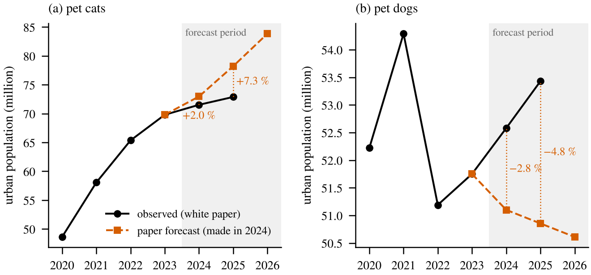
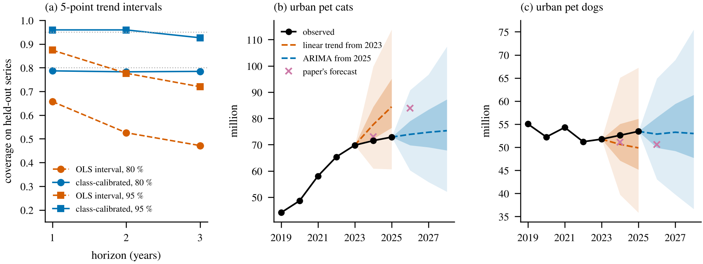

# China's pet industry: population forecasts, global demand, industry coupling and policy impact

**Competition:** 2024 APMCM Asia-Pacific Mathematical Contest in Modeling, Problem C · entry apmcm24201771 · **Third Prize**

**Read first:** [`paper/Capmcm24201771_paper_en_extended.pdf`](paper/Capmcm24201771_paper_en_extended.pdf) — the extended edition: the submitted document, unchanged (Part I), followed by the post-competition extensions written up as Part II (pages E-1 to E-5). The file as submitted, `paper/Capmcm24201771_paper_en.pdf`, is kept as handed in.

The paper (English, 32 pages, `paper/`) builds a layered set of models for the pet economy: (1) combined
linear-regression / growth-rate forecasts of China's urban cat and dog populations; (2) a global market
model with demand elasticity and market interconnectivity to forecast pet-food demand in China, the US
and Europe; (3) a production–export coupling model for China's pet-food industry; and (4) a policy-impact
assessment (tariffs and trade measures) on exports. Code and data for the 2024 entry were not preserved,
so this repository contains the paper, a post-hoc check of its forecasts and a reference-class benchmark of
the forecasting method.

**Headline forecasts (paper, Problem 1):** urban pet cats rise from 72.97 million (2024) to 83.86 million
(2026), CAGR ≈ 7.3 %; pet dogs stay flat at 51.1 → 50.6 million. (The summary sheet prints these as
"8.386 million" and "5.06–5.1 million"; the source series are in units of 10⁴ animals, so the correct
reading is 83.86 and 50.6–51.0 million.)

## Post-competition extension E1: forecasts versus what happened

The two following editions of the China Pet Industry White Paper — the data source family the paper
used — report 2024 and 2025. Script: `extension/e1_forecast_check.py`.

| Species, year | Forecast (10⁴) | Observed (10⁴) | Error | Forecast growth | Observed growth |
|---|---:|---:|---:|---:|---:|
| Cats 2024 | 7 297 | 7 153 | +2.0 % | +4.5 % | +2.5 % |
| Cats 2025 | 7 823 | 7 289 | +7.3 % | +7.2 % | +1.9 % |
| Dogs 2024 | 5 110 | 5 258 | −2.8 % | −1.3 % | +1.6 % |
| Dogs 2025 | 5 085 | 5 343 | −4.8 % | −0.5 % | +1.6 % |



*Observed series: White Paper editions 2020, 2025 and 2026 (sources listed in `extension/e2_figure.py`);
forecasts: paper, Section 5. Script: `extension/e2_figure.py`.*

The one-year-ahead errors are small (±3 %), but the trend models extrapolated the 2019–2023 regime —
fast cat growth, slowly shrinking dog numbers — while both populations entered a common low-growth phase
(≈2 % a year). The cat forecast error therefore compounds (+7.3 % after two years) and the sign of the dog
trend is wrong. A regime-aware specification (logistic saturation or a penetration-rate model driven by
household formation) would have been the appropriate next step; the result is a concrete example of why
short trend series should carry widening prediction intervals rather than point forecasts.

## Post-competition extension E2: how much can five annual observations tell?

One Chinese series per species cannot show whether the forecast miss was bad luck or a property of the
method. E2 therefore evaluates the paper's method family, plus standard benchmarks, on a reference class of
real annual series: the 1 088 annual *Demographic* series of the M4 forecasting competition (Makridakis,
Spiliotis & Assimakopoulos, IJF 2020). One window is taken at the end of each series: five training values,
as in the paper, and the next three years as targets. Prediction intervals are calibrated on the class:
empirical quantiles of log(actual/forecast) are estimated on a random half of the series and tested on the
other half. Script: `extension/e3_reference_class.py`; the M4 files are downloaded at run time and are not
redistributed.

| Five training values, median absolute % error | h = 1 | h = 2 | h = 3 | Beats naive at h = 3 |
|---|---:|---:|---:|---:|
| Naive (last value) | 2.5 | 4.6 | 6.4 | — |
| Random walk with drift | 2.2 | 3.8 | 5.3 | 56 % |
| Linear trend (the paper's regression) | 2.9 | 4.4 | 5.8 | 53 % |
| Compound growth rate (the paper's CAGR) | 2.2 | 3.8 | 5.2 | 55 % |
| Grey model GM(1,1) | 2.5 | 3.9 | 5.4 | 55 % |
| ARIMA, AIC-selected | 2.2 | 3.8 | **4.8** | 38 % (often equals naive) |
| Theta | 2.2 | 3.9 | 5.1 | 60 % |
| Inverse-MSE combination (the paper's weighting) | 2.4 | 3.9 | 5.2 | 56 % |
| Equal-weight combination of the same three | 2.4 | 3.8 | 5.1 | 56 % |

* **The linear trend is the weakest trended method** at every horizon. Inverse in-sample-MSE weighting does no
  better than equal weights, and it gives the grey model the largest weight (0.55 on average).
* **In-sample fit is a weak guide.** Across windows the Spearman correlation between the five-point $`R^2`$ of the
  linear trend and its absolute three-year error is −0.27; the median three-year error is 8.0 % for $`R^2\le0.5`$,
  4.3–4.5 % for $`0.9\lt R^2\le0.99`$ and 1.4 % only for nearly exactly linear windows ($`R^2\gt 0.99`$). On a random sample
  of 4 000 of the 23 000 annual M4 series of all categories the linear trend is again the least accurate trended
  method at every horizon (three-year median error 8.1 % against 7.4 % for drift).
* **Classical regression intervals are far too narrow for five points.** The OLS prediction intervals of the
  linear trend contain the outcome in 66 / 53 / 47 % of held-out windows at nominal 80 %, and in 87 / 78 / 72 %
  at nominal 95 % (h = 1 / 2 / 3). The class-calibrated intervals reach 78–79 % and 93–96 %. The calibrated 95 %
  interval of a three-year linear-trend forecast spans −33 % to +50 % of the point forecast.
* **The direction of a two-year change** is predicted correctly in only 63–69 % of windows by the trended
  methods.
* **China, from the paper's 2023 vantage point.** The observed 2024 and 2025 values fall inside the
  calibrated 95 % interval of every method. For cats they fall below the 80 % interval of every trended
  method except the damped Theta method: 2025 linear trend 84.4 million, 80 % interval 76.5–95.1, observed
  72.9. The cat slowdown therefore lies below the class's 10 % quantile but above its 2.5 % quantile: unusual
  relative to the class, but not an impossibility.
  The dogs stay inside all 80 % intervals.
* **Re-implementation.** Rebuilding the paper's combination (linear trend, GM(1,1), ARIMA with inverse-MSE
  weights) reproduces its dog forecast closely: 51.05 vs 51.10 million for 2024, 50.20 vs 50.61 for 2026. It
  does not reproduce the cat forecast (78.0 vs 73.0 for 2024). The original code was not preserved, so the
  cat path cannot be traced.

Updated outlook from 2025, using ARIMA (with seven training values the most accurate method of the class at h = 1 and h = 3, and within 0.02 points of CAGR at h = 2)
and class-calibrated intervals, in 10⁴ animals:

| | 2026 | 80 % | 95 % | 2028 | 80 % | 95 % |
|---|---:|---|---|---:|---|---|
| Urban cats | 7 393 | 6 980–7 903 | 6 023–9 081 | 7 533 | 6 785–8 725 | 5 209–10 739 |
| Urban dogs | 5 284 | 4 989–5 649 | 4 305–6 490 | 5 297 | 4 771–6 135 | 3 663–7 551 |

The trended alternatives put cats higher in 2026: Theta 7 546, drift 7 769, linear 8 204. That spread is itself
the main message: with seven annual points the honest statement is an interval, not a CAGR.



*Fig. E2 — (a) Coverage of nominal 80 % (circles) and 95 % (squares) intervals for 5-point linear-trend
forecasts on held-out M4 Demographic series: classical OLS intervals against class-calibrated intervals.
(b, c) Observed series, the linear-trend forecast from 2023 with calibrated bands for the two check years, the
ARIMA outlook from 2025, and the paper's forecasts.*

## Reproduce

```bash
pip install numpy pandas scipy statsmodels matplotlib
python extension/e1_forecast_check.py && python extension/e2_figure.py
python extension/e3_reference_class.py        # ~10 min; downloads the M4 annual files (~30 MB) on first run
python extension/e4_figure_reference_class.py
```

## Licence

Paper: CC BY 4.0. Extension script: MIT.
