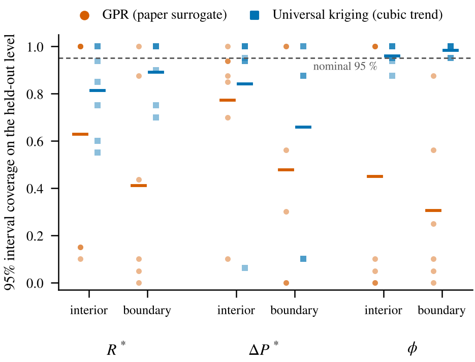
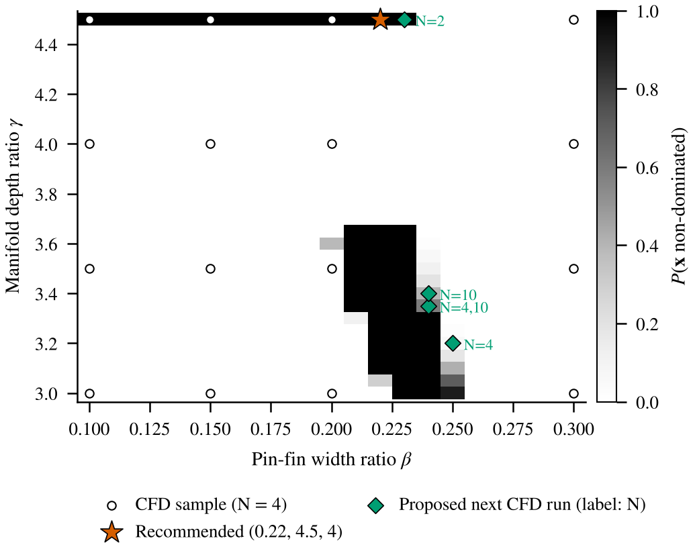
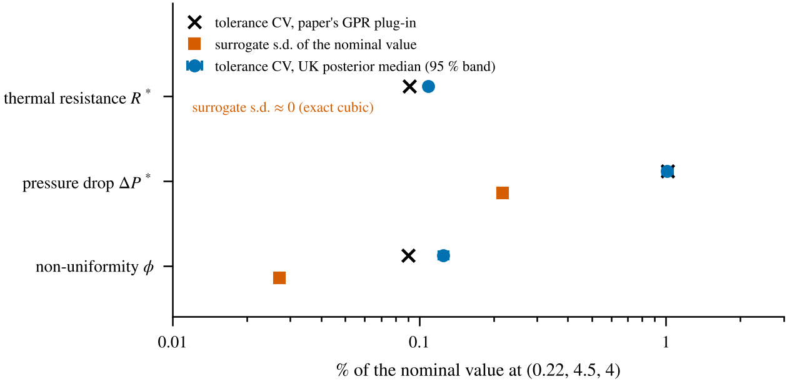

# Manifold micro-channel chip cooling: grey-box modelling, dual surrogates and robust multi-objective design

**Competition:** 16th APMCM Asia-Pacific Mathematical Contest in Modeling (Chinese track), 2026, Problem B · entry apmcm26202913

**Read first:** [`paper/Bapmcm26202913_paper_zh_extended.pdf`](paper/Bapmcm26202913_paper_zh_extended.pdf) — the extended edition: the submitted document, unchanged (Part I, in Chinese), followed by the post-competition extensions written up in English as Part II (pages E-1 to E-4). The file as submitted, `paper/Bapmcm26202913_paper_zh.pdf`, is kept as handed in.

A manifold micro-channel heat sink with pin fins is described by three design variables — pin-fin width
ratio $\beta$, manifold depth ratio $\gamma$ and pin rows per manifold unit $N$ — and three dimensionless
responses: thermal resistance $R^{\ast}$, pressure drop $\Delta P^{\ast}$ and temperature non-uniformity $\phi$.
Eighty-four CFD samples are given. The work builds a chain *grey-box physics → dual surrogates → three-objective
optimisation → preference-robust choice → tolerance analysis*, and this release adds an audit of the
surrogate layer and a decision analysis under surrogate uncertainty.

## Method (competition paper)

| Task | Model | Key evidence |
|---|---|---|
| Q1 mechanism | series thermal network (conduction + convection + capacity) with entrance-length, impingement and pin-wake corrections; additive pressure-loss decomposition; competition model for $\phi$ | Spearman 0.865 / 0.990 / 0.877; analytic optima $\beta_R^{\ast}=0.247$, $\beta_\phi^{\ast}=0.196$, $\gamma_\phi^{\ast}=3.83$ |
| Q2 surrogates | cubic response surface (RSM-3, accuracy proxy) + GPR-Matérn (uncertainty proxy), compared with RSM-2, SVR, KRR, RF, MLP under **strict nested LOOCV** | GPR $R^2$ 0.9986 / 0.9991 / 0.9966; RSM-3 $R^2$ 1.0000 / 0.9996 / 0.9998 |
| Q3 optimisation | 24 705-point grid + N-stratified NSGA-II, grid-convergence and SLSQP refinement; entropy-TOPSIS, equal-weight ideal point, Chebyshev | recommended $(\beta,\gamma,N)=(0.22,4.5,4)$: $R^{\ast}=0.7413$, $\Delta P^{\ast}=0.0848$, $\phi=0.7722$ |
| Q4 preference robustness | 5 151 weight vectors; min–max regret vs. $\varepsilon$-near-optimal coverage | $N=4$ family optimal for 76.8 % of weights; coverage-led robust design $(0.22,4.5,4)$ |
| Q5 tolerance | elasticities, 10-seed Sobol indices ($n=32\,768$), truncated-normal Monte Carlo inside the design box, operating sweeps | CV 0.09 % ($R^{\ast}$, $\phi$), 1.01 % ($\Delta P^{\ast}$); worst shift 6.24 % |

**Reproduction.** `python competition_code/run_all.py` reruns every computation and figure (≈21 min on one CPU).
In a clean environment Q1, Q2 and Q5 outputs matched the submitted files to the printed precision (one RF
$R^2$ differed in the 4th decimal); Q3 produced 891 instead of 884 Pareto points because of library-version
differences in the GPR fit, with identical recommended and robust designs.

## Post-competition extension

Scripts in `extension/`, outputs in `results/extension/` and `figures/extension/`.

### E1 · Leave-one-level-out validation exposes what LOOCV cannot

On a grid design, LOOCV keeps every neighbour of the held-out point. The recommended design sits on the
upper $\gamma$ boundary and inside the unsampled $0.20<\beta<0.30$ gap, so each level of $\beta$, $\gamma$ and $N$
was held out in turn (all 20 samples of a $\beta$ or $\gamma$ level, 16 of an $N$ level; the four pin-free base
cases stay in training) and the surrogates refitted.

* **$R^{\ast}$ in the data is an exact cubic polynomial.** A full cubic in $(\beta,\gamma,N)$ reproduces all 84
  $R^{\ast}$ values to a maximum residual of $5.2\times10^{-7}$ — the six-decimal rounding of the data — and
  predicts entire held-out levels with the same error. RSM-3's $R^2=1.0000$ is therefore identification of
  the generating surface, not evidence of surrogate skill; $\Delta P^{\ast}$ and $\phi$ carry genuine cubic
  residuals (maximum 2.6 % and 1.6 % of their range).
* **GPR intervals do not transfer to unseen levels.** The 95 % intervals that cover 92–100 % of points
  under LOOCV cover on average 31–77 % of a held-out level (41 % on boundary levels of $R^{\ast}$, 31 % for
  $\phi$).
* **A cubic-trend universal-kriging model repairs most of the calibration** (mean coverage 81–98 %,
  66 % for $\Delta P^{\ast}$ on boundary levels) while matching RSM-3 accuracy.



### E2 · Is the recommendation robust to the surrogate itself?

The paper tests robustness to preferences (Q4) and to manufacturing/operating perturbations (Q5). The
remaining source — the surrogate fitted to 84 samples — is propagated here: 1 000 joint posterior draws of
all three response surfaces over a 3 255-point design grid, each followed by Pareto extraction and the
three compromise rules.

* Under the calibrated universal-kriging posterior, $(0.22,4.5,4)$ is non-dominated in 100 % of draws and
  is the equal-weight ideal-point choice in **100 %** of draws; under the paper's GPR posterior the exact
  point wins 82.9 % and its $\pm1$-grid-step neighbourhood 100 %.
* The rule matters more than the surrogate: entropy-TOPSIS consistently selects $N=2$ (91.6 % at
  $(0.22,4.5,2)$) and Chebyshev $N=6$ — the paper's choice of the ideal-point rule is the decisive
  modelling step, not surrogate error.

### E3 · Where the next CFD runs should go

Because GP posterior variance does not depend on future outputs, a batch of five new simulations was
chosen greedily to minimise posterior variance over the decision-relevant region (designs with ambiguous
Pareto membership or non-zero win probability). Both surrogates point to the same deficit: four of five
proposed runs lie at $\beta\approx0.24$–$0.25$, $\gamma\approx3.2$–$3.55$, i.e. inside the unsampled
$\beta$ gap; the five runs remove 21 % (UK) to 53 % (GPR) of decision-region variance.



### E4 · The tolerance analysis (Problem 5) with the surrogate's own uncertainty

Problem 5 propagates manufacturing tolerances through the GPR surrogate, treating it as the truth: σ is 2 %
of β and 1.5 % of γ, as truncated normals inside the design box. E4 repeats the analysis on 1 000 joint
posterior draws of the calibrated universal-kriging surfaces. Each draw is evaluated exactly at 4 001 Monte
Carlo inputs (the tolerance sample, its Sobol column swaps and the nominal design). Script:
`extension/e5_tolerance_posterior.py`.

| At (0.22, 4.5, 4) | Tolerance CV, paper (GPR) | Tolerance CV, UK posterior median [95 % band] | Worst shift, paper → UK (median) | Surrogate s.d. of the nominal value |
|---|---:|---:|---:|---:|
| $R^{\ast}$ | 0.091 % | 0.109 % [0.109, 0.109] | 0.50 % → 0.54 % | ≈ 0 (the cubic is exact) |
| $\Delta P^{\ast}$ | 1.014 % | 1.011 % [0.968, 1.061] | 6.24 % → 5.97 % | 0.22 % |
| $\phi$ | 0.090 % | 0.125 % [0.120, 0.131] | 0.50 % → 0.59 % | 0.03 % |

* **The paper's Problem 5 conclusion survives the surrogate uncertainty.** The tolerance spread stays below
  about 1 % and is driven by γ: its first-order Sobol index exceeds β's in every posterior draw (0.96–1.0 for
  $R^{\ast}$ and $\phi$, 0.76 for $\Delta P^{\ast}$).
* **The paper's GPR understates the tolerance spread of $R^{\ast}$ and $\phi$:** its CV is 16 % and 28 % below the
  universal-kriging value. For
  $R^{\ast}$ the universal-kriging surface is the exact cubic that generated the data (E1), so 0.109 % is the
  correct value under the stated tolerances. The pressure-drop figures agree.
* **Tolerances, not the surrogate, dominate what is uncertain at the recommended design.** The posterior
  s.d. of the nominal performance is about one fifth of the tolerance-induced s.d. for $\Delta P^{\ast}$ and
  $\phi$ (ratio 0.21–0.22), and essentially zero for $R^{\ast}$ (ratio $\approx10^{-4}$).



*Fig. E3 — Tolerance-induced coefficient of variation (paper's GPR plug-in; UK posterior median with the 95 %
band over 1 000 draws) and the posterior standard deviation of the nominal performance, in % of the nominal
value.*

## Reproduce

```bash
pip install numpy scipy pandas scikit-learn joblib matplotlib pymoo
python competition_code/run_all.py                   # full competition pipeline (~21 min)
python extension/e1_level_holdout.py                 # ~15 s
python extension/e2_posterior_decision.py uk         # ~1 min (universal kriging posterior)
python extension/e2_posterior_decision.py gpr        # ~1 min (paper's GPR posterior)
python extension/e4_figures.py
python extension/e5_tolerance_posterior.py           # ~2 min (Problem 5 under the UK posterior)
python extension/e6_figure_tolerance.py
```

## Layout

```
competition_code/     submitted support package (代码 = code and outputs, 图表 = figures), README_zh.md
extension/            E1–E4 scripts, universal kriging (uk.py), figure style
results/extension/    E1–E4 tables and JSON summaries
figures/extension/    E1–E3 figures (PDF + PNG)
data/attachment2.tsv  the 84 CFD samples of Attachment 2 (APMCM organisers), for reproduction
paper/                competition paper (Chinese) as submitted, and its extended edition with Part II (*_extended.pdf)
```

## Limitations

The extension inherits the problem's 84-sample design; "exact cubic" refers to the published six-decimal
data and says nothing about the underlying CFD. Posterior probabilities are conditional on the surrogate
family and its hyper-parameters.

## Licence

Code: MIT. Paper and figures: CC BY 4.0. Attachment-2 data belong to the APMCM organisers.
