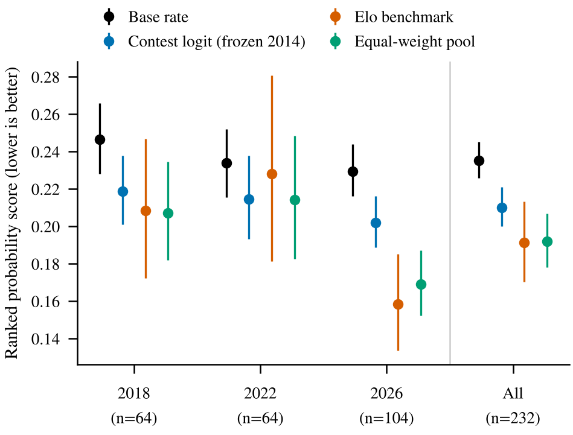
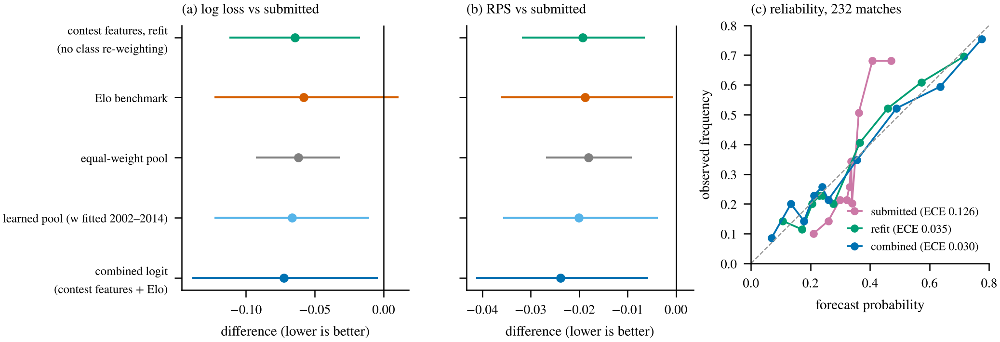

# World Cup data mining and match forecasting — with a prospective test on 2018, 2022 and 2026

**Competition:** 2026 APMCM Asia-Pacific University LLM Competition (亚太地区大学生大模型竞赛), Problem A

**Read first:** [`paper/contest_program_notes_zh_extended.pdf`](paper/contest_program_notes_zh_extended.pdf) — the extended edition: the submitted document, unchanged (Part I, in Chinese), followed by the post-competition extensions written up in English as Part II (pages E-1 to E-3). The file as submitted, `paper/contest_program_notes_zh.pdf`, is kept as handed in.

The problem asks for a fully automated Python pipeline on the 1930–2014 World Cup tables: descriptive
statistics and trends of tournament goals, a linear regression for total goals (scored against the
real 2018 total of 169), stage-wise goal analysis and a reusable single-match goal predictor, and a
multinomial logistic classifier for home win / draw / away win built on four team-history features
(appearances, best finish, goals scored and conceded per match), tested on 2014.

This repository contains three layers:

| Folder | What it is |
|---|---|
| `contest_submission/` | the submitted program (`python main.py`), exactly as handed in; program notes in `paper/contest_program_notes_zh.pdf`; the extended edition `paper/contest_program_notes_zh_extended.pdf` adds the post-contest extensions as Part II |
| `research/` | a research-grade continuation written after the contest: leakage-safe joint-goal models (independent Poisson, Dixon–Coles, adaptive bivariate Poisson), seven expanding-origin folds, a one-shot 2014 audit and a 2026-format tournament simulator (`paper/research_paper_en.pdf`) |
| `extension/` | this release: a **prospective** evaluation on the 232 World Cup matches played after the data end |

## Contest results (as submitted)

| Question | Result |
|---|---|
| Q1 regression of total goals on teams, matches, attendance | 2018 prediction 160.10 vs. 169 actual; $R^2=0.792$ (adj. 0.753), max VIF 18.4 |
| Q3 four-feature multinomial logit, trained 1930–2010, tested 2014 | 37/64 correct (accuracy 0.578) |

The research layer documents an honest negative result: in its one-shot 2014 audit the advanced
calibrated model (log loss 1.0227) did **not** beat the legacy Dixon–Coles comparator (0.9851), and that
result was kept rather than re-tuned. Its own report concludes that any improved model needs a new,
future holdout.

## Post-competition extension: a genuine future holdout

Three World Cups have been played since the data end: 2018 (64 matches), 2022 (64) and 2026 (104, the
first 48-team edition). The submitted classifier is applied **unchanged** — team histories frozen at
2014 — to all 232 matches, and compared with an external benchmark that uses information the contest
data did not contain: World Football Elo ratings updated on every international match (49 000+ matches,
[martj42/international_results](https://github.com/martj42/international_results), CC0), mapped to W/D/L
probabilities by an ordered logit fitted only on 1930–2014 World Cup matches. Outcomes are taken after extra
time, as in the training data. Script: `extension/e1_prospective_holdout.py`.

| Model (232 matches) | Log loss | RPS | Brier | Accuracy |
|---|---:|---:|---:|---:|
| Base rate (1930–2014 frequencies) | 1.064 | 0.235 | 0.644 | 0.440 |
| **Contest logit, frozen 2014** | 1.008 | 0.210 | 0.605 | 0.578 |
| Elo benchmark (ordered logit) | 0.950 | 0.191 | 0.556 | 0.578 |
| Equal-weight pool (contest + Elo) | **0.946** | 0.192 | 0.559 | **0.603** |

Paired match-level bootstrap (5 000 resamples):

* the contest model beats the base rate on every proper score (log loss −0.056, 95 % CI [−0.094, −0.016]);
* Elo improves on the contest model in RPS (−0.019, [−0.037, −0.0005]) and Brier, while the log-loss gain
  (−0.058, [−0.124, +0.009]) is not significant — 2022, the edition of Saudi Arabia–Argentina and
  Japan–Germany/Spain, is the one tournament where the World-Cup-history features beat Elo;
* pooling the two is significantly better than the contest model alone (log loss −0.062, [−0.092, −0.031]),
  i.e. long-run World Cup pedigree carries information that recent international form does not.

15 % of the 232 matches involve a team with no World Cup record before 2014 (e.g. Iceland, Panama, Qatar,
Cape Verde), for which the contest model falls back to a neutral prior.



*Fig. E1 — Ranked probability score by tournament with 95 % bootstrap intervals.*

### E2 — where the gap comes from, and a better forecaster frozen before 2018

The submitted classifier was trained with `class_weight='balanced'`, which maximises balanced accuracy rather
than the quality of the probabilities. On the 232 prospective matches its mean draw probability is 0.332,
against an observed draw rate of 0.224. E2 refits the forecaster for probabilities and freezes every
candidate before 2018. Regularisation is chosen by leave-one-tournament-out log loss over 1982–2010, the
contest's own selection window, and the pool weight comes from rolling-origin forecasts of 2002–2014.
Script: `extension/e2_improved_forecaster.py`.

| Model (232 matches) | Log loss | RPS | Brier | Accuracy | Calibration error (ECE) |
|---|---:|---:|---:|---:|---:|
| Contest logit, submitted (balanced class weights) | 1.008 | 0.210 | 0.605 | 0.578 | 0.126 |
| Same four features, refit without re-weighting | 0.944 | 0.191 | 0.555 | 0.586 | 0.035 |
| Elo benchmark (ordered logit) | 0.950 | 0.191 | 0.556 | 0.578 | 0.042 |
| Equal-weight pool (submitted + Elo) | 0.946 | 0.192 | 0.559 | **0.603** | 0.064 |
| Learned pool (weight 0.10 on the submitted model) | 0.942 | 0.190 | 0.553 | 0.578 | 0.032 |
| **Combined logit (four features + pre-match Elo difference)** | **0.936** | **0.186** | **0.544** | 0.595 | **0.030** |

Paired match-level bootstrap (5 000 resamples), 95 % intervals:

* Dropping the class re-weighting alone improves log loss by 0.064 [0.017, 0.112] and RPS by 0.019
  [0.006, 0.032]. It also brings the four World-Cup-history features level with Elo (log loss
  −0.006 [−0.057, +0.041]). Most of the E1 gap was therefore caused by the loss function, not by missing
  information.
* The combined logit is best on all three proper scores and has the lowest calibration error. Its margin
  over Elo, however, is not significant on 232 matches: log loss −0.014 [−0.037, +0.009], RPS −0.005
  [−0.011, +0.001].
* The ranking changes from one tournament to the next:

  | Edition | Refit features minus Elo (log loss) | Combined logit minus Elo (log loss) |
  |---|---|---|
  | 2018 | −0.007 [−0.086, +0.066] | −0.005 [−0.043, +0.034] |
  | 2022 | −0.078 [−0.162, +0.002] | −0.001 [−0.040, +0.044] |
  | 2026 | +0.038 [−0.046, +0.121] | −0.029 [−0.066, +0.008] |

  Splitting by match type, the 2026 deficit of the history features comes from games between teams with a
  World Cup record up to 2014 (0.911 vs 0.826, 79 games). On the 25 games involving a team without such a
  record they are better (0.854 vs 0.963).
* A permutation test does not reject equal tournament-level gaps (p = 0.17). The combined logit's point
  estimate is at or below Elo's in every edition (−0.005, −0.001, −0.029), so it is the more robust single
  forecaster rather than a significantly better one.



*Fig. E2 — (a, b) Log loss and RPS of each candidate relative to the submitted classifier, with 95 % paired
bootstrap intervals. (c) Reliability of the outcome probabilities, pooled over the three outcomes, in deciles.*

## Reproduce

```bash
pip install numpy pandas scipy scikit-learn matplotlib statsmodels
cd contest_submission && python main.py --demo && cd ..   # six questions + demo predictions (formal mode reads testdata/query.csv)
python extension/e1_prospective_holdout.py                 # ~10 s
python extension/e2_figures.py
python extension/e2_improved_forecaster.py                 # ~20 s
python extension/e3_figure_e2.py
# research layer
cd research && pip install -e . && python -m pytest -q
```

In this release the research test suite reports 328 passed, 14 failed and 1 skipped; the failures are
release-builder and provenance checks that require the original Git history and the 81 MB evidence cache,
which are not redistributed.

## Data

`contest_submission/data/` holds the three CSV tables distributed with the problem (Kaggle "FIFA World Cup"
dataset). `data/external/international_results.csv` is the CC0 international-results file used for the
Elo benchmark; its SHA-256 is recorded in `results/extension/e1_summary.json`.

## Licence

Code: MIT. Documents and figures: CC BY 4.0. Third-party data keep their own licences.
