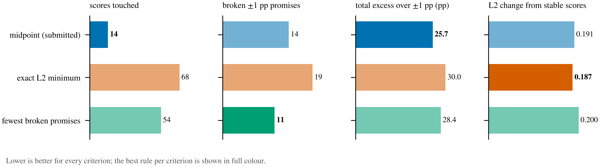
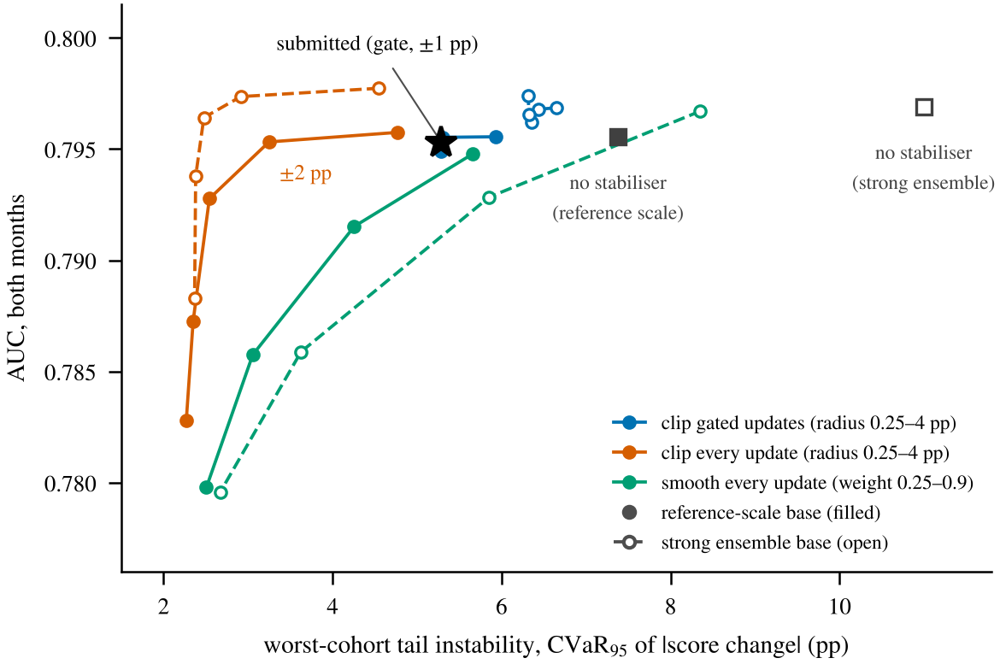

# Stable credit scores after credit-limit increases, with capacity-protected review lists

**Competition:** 2026 FinTechathon — Shenzhen International Fintech Competition (深圳国际金融科技大赛), data-analysis track, Task 1 · entry 043

**Read first:** [`paper/043_report_extended_zh.pdf`](paper/043_report_extended_zh.pdf) — the extended edition: the submitted document, unchanged (Part I, in Chinese), followed by the post-competition extensions written up in English as Part II (pages E-1 to E-3). The file as submitted, `package/043-赛题1.pdf`, is kept as handed in.

When a bank raises a customer's credit limit, utilisation falls mechanically even if the customer borrows
more, so behaviour-driven risk scores move for reasons that are the bank's own action. The task asks for
a score that is discriminative **and** stable for customers whose risk has not materially changed. The
submission rebuilds customer states from 3.84 million public credit-card account-months (103 558
customers, Home Credit Default Risk `credit_card_balance`) and proposes one final score built from three
parts:

1. **Reference scale** — all history features are recomputed at a fixed reference limit inside a reference
   period, so the limit increase itself does not move utilisation-type features, while new balances,
   drawings and payments are absorbed immediately.
2. **Near-stable update** — for customers whose account flows stay within a stability gate, the new score
   is kept within ±1 pp of the previous one.
3. **Capacity protection** — the stabilised scores are minimally relaxed so that the base model's top-k
   review list (10 %; six capacities 5–20 % in the multi-capacity version) is preserved exactly.

A six-page review workbench (queue, account analysis, evidence handling, AI agent, hand-over) turns the
score into casework.

## Results reported in the submission (re-verified)

| Evidence | Result |
|---|---|
| Discrimination in the limit-increase month (2 907 customers) | AUC 0.8171 |
| Two review rounds, 559 slots | 61 distinct customers with early delinquency in the next three months covered, 2 more than the original capped update |
| Tail stability among customers with similar repayment state / payment structure | mean of the most extreme 5 % score changes 39.5–68.8 % smaller than a strong risk ensemble |

On the complete (private) package, `package/code/verify_batch.py` replays 8 491 states and 5 584 updates (list
retention, batch completeness, tie handling, repeated submissions) and `package/scoring/verify_examples.py`
reproduces the deployed scorer to 1e-16; both pass, and the replay of the guard reproduces the published
final-score column exactly (max |Δ| = 0). Both scripts, like the extension, read row-level inputs that are
withheld from this public release (see *Data* below).

## Post-competition extension E1: which separating threshold should the guard use?

The guard enforces membership by clipping the stability candidates $z$ at a threshold $\tau$ placed at the
midpoint of the k-th and (k+1)-th **base** scores. Any $\tau$ separating the protected set from the rest is
admissible, so the threshold is a free design choice. For fixed $\tau$ the closest admissible score is
$f_i=\max(z_i,\tau^+)$ for protected and $f_j=\min(z_j,\tau)$ for unprotected customers, and the squared
change $C(\tau)=\sum_{P}(\tau-z_i)_+^2+\sum_{U}(z_j-\tau)_+^2$ is convex with monotone derivative, so the
exact L2 minimum-change guard is obtained by bisection. A second rule chooses $\tau$ to minimise,
lexicographically, the number of gated customers pushed outside the ±1 pp stability promise, the total
excess and the total change. All three rules were replayed through the identical sequential procedure
(phases, cross-fitted folds, gates, radius 0.01, 10 % capacity). Script: `extension/e1_optimal_guard.py`.

| Guard threshold (5 584 updates) | Scores touched | Broken stability promises | Total excess over ±1 pp | L2 change | AUC (increase month) |
|---|---:|---:|---:|---:|---:|
| Midpoint of base scores (submitted) | **14** | 14 | **25.7 pp** | 0.191 | 0.8171 |
| Exact L2 minimum change | 68 | 19 | 30.0 pp | **0.187** | 0.8171 |
| Fewest broken promises | 54 | **11** | 28.4 pp | 0.200 | 0.8171 |



* No rule dominates. The "minimum-change" label of the submitted guard is true in the sense that matters
  operationally — it touches the fewest scores and adds the least excess — but **not** in the L2 sense its
  docstring suggests; the exact L2 projection spreads small changes over five times as many customers.
* If the business promise is the number of customers whose score breaks the ±1 pp band, a different
  threshold cuts broken promises from 14 to 11 (−21 %) at the price of small adjustments to 40 extra,
  ungated customers.
* Discrimination is unaffected by the choice (AUC identical to four decimals), and the top-10 % list is
  identical by construction; the choice is a pure operating-policy decision and can be exposed as a
  parameter of the scorer.

## Post-competition extension E2: is the gate necessary, and is ±1 pp the right radius?

The final score uses two further design choices. A customer's score is held within 1 pp of the previous
score, and only when the account flows pass the stability gate. The generic tools from the
prediction-churn literature drop the gate and instead clip or exponentially smooth *every* update. E2
replays these variants through the identical sequential procedure: the same phases, out-of-fold batches,
per-fold 10 % quotas and capacity guard. Every variant built on a base model therefore reviews exactly the
same customers as that base model, and only stability and discrimination move. The parameterised replay
reproduces the published final score exactly (max |Δ| = 0). Script: `extension/e3_stability_frontier.py`
(aggregate outputs only).

Tail instability is measured as the paper does: the mean of the largest 5 % of absolute score changes
(CVaR₉₅). It is reported for the worst of the three unchanged-risk cohorts (gate-stable, similar repayment
state, similar payment structure) in either month. The paired intervals below come from a customer-level
bootstrap with 1 000 resamples.

| Variant (reference-scale base) | AUC, both months | Worst-cohort CVaR₉₅ (pp) | Δ AUC vs submitted [95 % CI] | Δ CVaR₉₅ [95 % CI] |
|---|---:|---:|---|---|
| No stabiliser | 0.7956 | 7.38 | — | — |
| **Submitted: gate, ±1 pp** | 0.7953 | 5.29 | — | — |
| Gate, ±0.25 … ±2 pp | 0.7949–0.7955 | 5.29–5.30 | — | — |
| Every update clipped, ±2 pp | 0.7953 | **3.25** | [−0.0020, +0.0026] | [−3.33, −1.08] |
| Every update clipped, ±1 pp | 0.7928 | 2.54 | [−0.0080, +0.0023] | [−4.03, −1.75] |
| Every update smoothed, weight 0.75 | 0.7857 | 3.06 | — | — |



*Fig. E2 — AUC against worst-cohort tail instability. Lines trace the radius (clipping) or weight
(smoothing) sweeps. Filled markers use the submission's reference-scale base model, open markers the strong
risk ensemble.*

* **The radius is on a flat stretch.** Between 0.25 and 2 pp the worst cohort does not move. That cohort is
  "similar repayment state" in the increase month, and the gate covers only 38 % of its 1 063 transitions
  (`results/extension/e3_gate_coverage.json`), so its tail comes from ungated customers.
* **Dropping the gate moves the frontier.** Clipping every update at ±2 pp leaves AUC unchanged and lowers
  the worst-cohort tail by 39 % (5.29 → 3.25 pp; the interval excludes zero). Exponential smoothing, the
  distillation-style alternative, is dominated by clipping: equal tail stability costs more AUC.
* **The paper's comparison with the strong risk ensemble holds:** without stabilisation that ensemble is
  far less stable (CVaR₉₅ 10.99 pp; 95 % bootstrap interval of the difference to the submission
  [+2.9, +8.2] pp). Given the same
  every-update clipping at ±2 pp, however, it reaches AUC 0.7974 and CVaR₉₅ 2.91 pp (reference-scale base:
  0.7953 and 3.25 pp). Against the submission the 95 % interval of its tail difference is [−3.9, −1.0] pp, and its AUC difference
  interval (−0.006, +0.010) includes zero. Its review lists cover one fewer delinquent customer (60 vs 61).
  Much of the stability therefore comes from the stabiliser rather than from the reference scale.
* **What the gate is for cannot be tested with these labels.** The gate exists so that customers whose
  risk genuinely changes are not held back. In this sample, however, even the unstabilised base model does
  not raise the scores of customers who go on to an early delinquency in the increase month (mean change
  −0.30 pp; 46 % rise). The case for the gate thus rests on the design argument, and E2 suggests offering
  "clip every update at ±2 pp" as the default operating policy, with the gate as an option.

## Data and what is (not) included

The main panel is the public Home Credit Default Risk data (Kaggle competition terms), with PPDai,
Prosper and Xinyan data for external checks. **No row-level data are redistributed**: all parquet inputs,
per-customer evidence (memberships, receipts, queues, case files), the single-file workbench pages with
embedded customer accounts and the trial answer keys were removed — 58 files, listed in
`docs/excluded_files.json`. The aggregated evidence tables, figures, model artefacts, the full source
code (pipeline, scorer, workbench front-end and agent server) and the report are included. To rerun the
scorer and the extension, rebuild the inputs from the Kaggle data with the competition-stage research
package, or contact the author.

## Reproduce (requires the withheld row-level inputs)

```bash
pip install numpy pandas scikit-learn matplotlib pyarrow
python extension/e1_optimal_guard.py <path-to-043-package> results/extension        # E1, threshold rules
python extension/e2_figure.py
python extension/e3_stability_frontier.py <path-to-043-package> results/extension   # E2, ~5 min incl. bootstrap
python extension/e3b_gate_coverage.py <path-to-043-package> results/extension      # E2, gate coverage of the cohorts
python extension/e4_figure_frontier.py
```

## Layout

```
package/          submitted package without row-level data (code/, scoring/, product/, paper/, figures/, evidence/)
package/043-赛题1.pdf   final report (Chinese, 8-page main text + appendix), as submitted
paper/043_report_extended_zh.pdf   extended edition: the final report unchanged, followed by Part II (post-competition extensions)
extension/        threshold-design (E1) and stability-frontier (E2) studies and figure scripts
results/extension/ aggregate summaries of the replay comparisons
figures/extension/ extension figures
docs/             list of files withheld for data-licence reasons
```

## Licence

Code: MIT. Report and figures: CC BY 4.0. Source data remain under their providers' terms.
