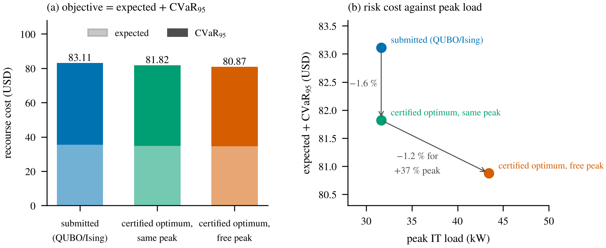
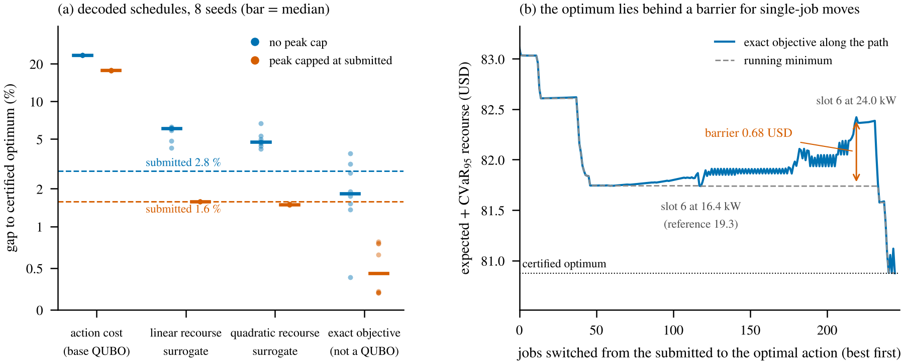

# TAILOR-DC-SAFE: risk-aware compute–power co-scheduling as bounded QUBO/Ising action selection

**Competition:** Ising Intelligent Computing Future Challenge (伊辛·智算未来挑战赛), 2026, energy-scheduling track · entry YX2600013

**Read first:** [`paper/TAILOR_DC_SAFE_paper_zh_extended.pdf`](paper/TAILOR_DC_SAFE_paper_zh_extended.pdf) — the extended edition: the submitted document, unchanged (Part I, in Chinese), followed by the post-competition extensions written up in English as Part II (pages E-1 to E-3). The file as submitted, `paper/TAILOR_DC_SAFE_paper_zh.pdf`, is kept as handed in.

A data-centre operator must place 588 AI jobs on a time grid with five power-price / renewable /
demand scenarios, trading action cost against the expected and tail (CVaR₉₅) cost of real-time recourse
while respecting job deadlines and a site peak. The solution encodes the choice of one action per job
(normal, delay, degrade, horizon rescue, …) as a one-hot QUBO with 1 929 spins, solves neighbourhood
sub-problems on the organisers' Ising platform (Plectrum SDK) and classically, and treats the solver energy
only as a search proxy: every candidate is decoded, repaired, guarded and re-scored by an independent
scenario replay. The frozen schedule is validated by a standard-library-only replay.

| Frozen result (independent replay) | Value |
|---|---:|
| Jobs / binary action variables (spins) | 588 / 1 929 |
| One-hot violations / dummy actions | 0 / 0 |
| Expected recourse cost | 35.395 USD |
| CVaR₉₅ recourse cost | 47.718 USD |
| Peak IT load | 0.03165 MW |

The competition report documents baselines (greedy, local search, random feasible schedules), penalty
sweeps, tail scenarios and an important diagnostic: across neighbourhood families the QUBO energy is
almost perfectly correlated with the action cost but *negatively* correlated with the recourse cost
(r ≈ −0.98), which is why the final schedule comes from recourse-aware polishing rather than from the
lowest-energy sample. Exact MILPs were solved for controlled neighbourhoods of 30, 60 and 100 jobs.

## Post-competition extension E1: an exact certificate for the whole instance

The submission's exact model — one action per job, five-scenario recourse with CVaR₉₅ linearisation,
objective Expected + CVaR₉₅, the same action-cost guard (minimum real-action cost + 1 USD), no dummy
actions — was built for **all 588 jobs** (1 739 variables, 1 365 integer, 1 153 constraints) and solved
with HiGHS to proven optimality (1.18 million nodes, 22 min). A second solve adds the submitted schedule's
peak as a hard cap. Script: `extension/e1_full_exact.py`; result: `results/extension/e1_full_exact.json`.

| Schedule | Expected | CVaR₉₅ | Expected + CVaR₉₅ | Peak IT (MW) | Jobs changed |
|---|---:|---:|---:|---:|---:|
| Submitted (QUBO/Ising + recourse polish) | 35.395 | 47.718 | 83.113 | 0.0316 | — |
| Exact optimum, peak capped at submitted value | 34.796 | 47.023 | 81.820 | 0.0316 | 224 |
| Exact optimum, unconstrained peak | 34.460 | 46.414 | **80.874** | 0.0434 | 244 |



* The submitted schedule is **within 1.6 %** of the certified optimum at the same peak load and within
  2.8 % of the global optimum; both gaps are now proven, not estimated.
* The last 1.2 % of risk cost is bought with a 37 % higher peak — the risk objective alone pushes load into
  cheap-but-concentrated slots, so the peak cap is a substantive operating constraint, not a tie-breaker.
* The MILP's recourse values agree with the independent evaluator to 10⁻¹³ USD, so the certificate and the
  submitted replay measure exactly the same objective.
* A lexicographic third solve (minimum peak among risk-optimal schedules) did not finish within 25 min.

Because the exact MILP closes the instance in minutes on one CPU, the honest reading is that this instance
is small enough for classical certification; the value of the Ising formulation lies in its
neighbourhood-decomposition workflow and in scaling to instances where the MILP no longer closes.

## Post-competition extension E2: what limits the annealing route — the energy, the search or the landscape?

E1 left one question open: why does the Ising pipeline stop 1.6–2.8 % above an optimum that a MILP certifies
in minutes? E2 gives one simulated annealer, with one-hot-preserving single-job moves and the guard and
optional peak cap enforced as a constraint-preserving mixer would, four energies. Every decoded schedule is
scored with the package's exact evaluator, with 8 seeds and 12 × 10⁶ proposed moves per run. Script:
`extension/e3_aligned_energy.py`.

| Annealing energy | Rank agreement with the objective | Gap, no cap: best / median | Gap, peak capped: best / median |
|---|---:|---:|---:|
| Action cost (the base QUBO formulation) | −0.89 | 23.5 % / 23.5 % | 17.7 % / 17.7 % |
| Linear recourse surrogate (slot marginal costs, cf. the submission's "aligned recourse" family) | −0.51 | 4.3 % / 6.1 % | 1.6 % / 1.6 % |
| Quadratic recourse surrogate (per-slot fit, trust-region refits) | **+0.66** | 4.2 % / 4.7 % | 1.5 % / 1.5 % |
| Exact objective (not QUBO-representable) | — | **0.39 % / 1.83 %** | **0.20 % / 0.44 %** |
| *Submitted schedule* | | *2.8 %* | *1.6 %* |

Rank agreement is the Spearman correlation between the energy and the exact objective along the annealing
trajectories without a cap. The capped runs start from the submitted schedule, because the cheapest schedule
violates the cap.

* **The energy is the first limit.** The base energy ranks schedules against the objective, and its
  minimiser is the cheapest schedule, 23 % above the optimum. A first-order recourse energy still
  anti-correlates. A quadratic surrogate turns the agreement positive, but it stalls 4–5 % above the
  optimum without the cap and only matches the submitted schedule with it.
* **The search is the second.** Annealing the exact objective with the same move set and budget gets within
  0.2–0.4 % of the certified optimum at best, but the medians (0.4–1.8 %) show that single-job annealing does
  not reliably get there.
* **The landscape explains why.** Steepest descent from the submitted schedule stops after 15 single-job
  moves at 83.03 USD (4 moves with the cap). On the best-first single-job path from the submitted schedule to
  the optimum (244 switches, no cap), the objective first falls to 81.74 USD. It then has to climb 0.68 USD
  while slot 6 is filled from 16.4 kW past its reference load of 19.3 kW to 24.0 kW. Only then does it
  descend to 80.87 USD, as slot 6 reaches 29.1 kW and the number of slots loaded above their reference falls
  from 5 to 3. Above its reference a slot's flexibility shortfall is capped, so piling load into a few
  "sacrificial" slots pays only once a slot is full. A descent method sees only the cost of the first jobs.
  (The capped path crosses the peak cap and is not used.)

An Ising formulation that is to compete here needs both an energy that carries the recourse kinks, for
example auxiliary spins per slot and scenario for the saturating penalty, and collective moves. Neither the
submitted QUBO nor smooth surrogates provide them, and at this scale the MILP remains the right tool.



*Fig. E2 — (a) Gap of the decoded schedules to the certified optimum by annealing energy (8 seeds; bar =
median), without and with the peak cap; dashed lines mark the submitted schedule. (b) Exact objective along
the best-first single-job path from the submitted schedule to the certified optimum.*

## Reproduce

```bash
python deliverables/final_solution_package/validate_final_solution.py   # frozen replay, standard library only
pip install numpy pandas scipy pyarrow
python extension/e1_full_exact.py . results/extension 1500               # exact certificate (~50 min, HiGHS via SciPy)
python extension/e2_figure.py                                            # figure from the certificate
pip install numba
python extension/e3_aligned_energy.py                                    # E2 annealing study (~6 min)
python extension/e4_figure_aligned_energy.py
```

Full solver reproduction (`src/01_download` … `src/08_repair_pools`) requires the raw data listed in
`DATA_PROVENANCE.md` (not redistributed) and the organisers' Plectrum SDK. See `NOTICE.md` for the
redistribution status of third-party inputs.

## Layout

```
deliverables/final_solution_package/   frozen schedule, metrics, QUBO matrices, solver runs, validator
deliverables/competition_report/       competition report (Markdown) and tables
src/  tests/  instances/               pipeline (download → clean → actions → scenarios → bilevel → Ising → repair)
paper/                                 competition paper (Chinese) as submitted, and its extended edition with Part II (*_extended.pdf)
extension/  results/extension/  figures/extension/   exact certificate (E1), annealing diagnosis (E2), figures
docs/README_original.md                original repository README
```

## Licence

The original repository records no general licence for third-party inputs (see `NOTICE.md`). Code written for
this project: MIT. Paper and figures: CC BY 4.0.
