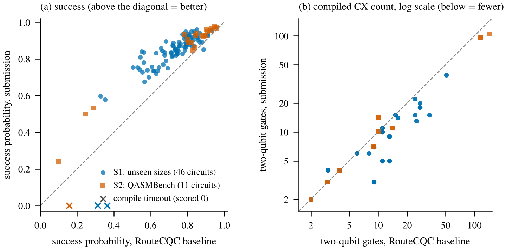
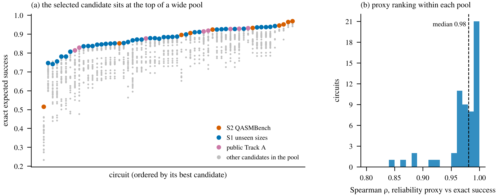

# Noise-adaptive quantum compiler for a dual-track NISQ mapping challenge

**Competition:** Noise-adaptive quantum compilation challenge (量旋杯), 2026 — organisers' framework by SpinQ Technology (MIT)

**Read first:** [`report/report_extended.pdf`](report/report_extended.pdf) — the extended edition: the submitted document, unchanged (Part I), followed by the post-competition extensions written up as Part II (pages E-1 to E-5). The file as submitted, `report/report.pdf`, is kept as handed in.

A black-box compiler maps input circuits onto noisy hardware snapshots (coupling map, per-edge two-qubit
error, per-qubit readout error) and is scored by the noisy success probability of the evaluator's
expected outcome: Track A, general NISQ circuits simulated with Cirq; Track B, large Clifford circuits
simulated with Stim; final score = 0.75 A + 0.25 B. Outputs must pass validator, equivalence and noiseless
semantic checks.

## Method (submission)

A deterministic pass pipeline (`compiler.py`, `src/noise_adaptive_hackathon/submission/`): noise-weighted
coupling graph with edge cost $`-\log(1-\varepsilon_{2q})`$ and readout cost $`-\log(1-\varepsilon_{ro})`$; an
ensemble of noise-aware initial layouts; bounded look-ahead routing with CX-decomposed moves, bridge
candidates and terminal readout remapping; exact GHZ fan-out trees; fixed-layout RouteCQC candidates;
peephole cancellation; guarded GF(2) and KAK block resynthesis; affine measurement-channel parity
resynthesis for Clifford hub-leaf circuits; and a proof-carrying **row-phase rewrite** that replaces exact
6-CX Toffoli decompositions by 3-CX relative-phase Toffolis whenever the whole circuit is row-phase
equivalent at the final Z measurement ($`U' = DU`$ with $`D`$ diagonal), which preserves every output
probability for every input state. Candidates are selected on a Pareto frontier of estimated log
reliability, two-qubit count, depth, readout cost and Clifford fault sensitivity.

| Public evaluation (7 seeds) | Track A | Track B | Final | Invalid |
|---|---:|---:|---:|---:|
| Organisers' baseline | 0.750 | 0.400 | 0.663 | 0 |
| Submission | 0.894 | 0.650 | **0.833** | 0 |

Clean re-run in this release (seed 7): final 0.8274 vs. 0.8276 recorded (Track A identical; Track B within
sampling noise of the simulator version). The submitted report with ablations, residual analysis and the
row-phase proof audit is in `report/` and `submission_package/1_Report/`.

## Post-competition extension E1: does the compiler generalise beyond the eight public Track A circuits?

The public set has eight 6–7-qubit Track A circuits. Two new suites were built in the challenge format
(`extension/build_suites.py`) and scored with the organisers' evaluator against their RouteCQC baseline
(`extension/run_suites.py`, seeds 7 and 11, 256 shots):

* **S1 — unseen sizes:** every Track A family from the organisers' own generator at 5, 8 and 11 program
  qubits (46 circuits, medium 16-qubit backend);
* **S2 — external circuits:** 11 QASMBench circuits (Pacific Northwest National Laboratory; adder,
  Toffoli, Fredkin, hidden shift, Grover, LPN, QEC encoder, SAT, cat state, iSWAP), re-measured on all qubits.

| Suite | Submission | RouteCQC baseline | Gap | Circuit-seed pairs better / worse (±0.02) | Mean CX, submission vs. baseline |
|---|---:|---:|---:|---:|---:|
| S1 unseen sizes (46 × 2) | 0.831 | 0.723 | **+0.108** | 87 / 3 | 9.6 vs. 14.8 |
| S2 QASMBench (11 × 2) | 0.818 | 0.753 | **+0.065** | 18 / 1 | 18.6 vs. 28.9 |



The advantage carries over to new sizes and to independently written circuits, largest for adders
(+0.20) and the 7-qubit SAT circuit (+0.25), with roughly 35 % fewer two-qubit gates.

**Failure mode found: compile time.** Even with a 60-s evaluator limit, the two largest circuits exceeded the
time budget and scored zero: the 11-qubit `structured_random` instance under both seeds, and the 10-qubit
QASMBench adder (81 CX in the input) under one of the two (with seed 7 it compiled in 49.6 s to 104 CX against
144 for the baseline). Under the official 30-s limit the adder fails as well. A deadline guard
(`extension/compiler_guarded.py`) runs the submitted compiler with a 24-s internal budget and otherwise
emits the RouteCQC baseline, so a slow compile degrades to the baseline score instead of an invalid
sample:

| Official 30-s limit, seed 7 | Submission | Guarded submission | Invalid (submission → guarded) |
|---|---:|---:|---:|
| S1 unseen sizes | 0.829 | **0.836** | 1 → 0 |
| S2 QASMBench | 0.801 | **0.810** | 1 → 0 |

## Post-competition extension E2: how much does candidate selection leave on the table?

The compiler builds a pool of valid compilations per circuit and selects one in two steps. A reliability
proxy (sum of log(1 − error) over gates and readouts, with Pareto guards) ranks the pool. The proxy's choice
and its top 8 are then re-scored by a 512-shot noisy simulation with common random numbers. With a standard
error of about 0.02 per estimate, the second step can keep a worse candidate or pick a lucky one. E2 scores
every candidate in every pool by its *exact* expected success: the density matrix of the circuit under the
evaluator's own noise model, summed over the accepted bitstrings. It then compares selection rules on the
same pools. Script: `extension/e4_selection_headroom.py`.

57 of the 65 circuits (8 public, 46 S1, 11 S2) were scored exactly (8 public, 39 S1, 10 S2; 1 520 candidates). In the other 8
(the four hidden-shift instances, both 11-qubit structured-random instances, one 11-qubit Bernstein–Vazirani
instance and the 10-qubit QASMBench adder), dense density-matrix simulation of at least one candidate
(up to 12 qubits after routing) took more than 60 s, and such circuits are left out whole.

| Selection rule (57 circuits) | Mean exact success | Circuits below the best in the pool |
|---|---:|---:|
| Proxy with Pareto guards | 0.8752 | 7 |
| Raw proxy, top candidate | 0.8756 | 4 |
| **Submitted (proxy + 512-shot re-scoring)** | 0.8754 | 5 |
| Exact evaluation of the proxy's top 8 | 0.8758 | 1 (by 2·10⁻⁶) |
| Best candidate in the pool | 0.8758 | — |

* **Selection is saturated.** The best candidate in the pool beats the submitted choice by only 0.0004 on
  average (at most 0.014, in one 11-qubit adder). Exact scoring of the top 8 that the submission re-scores
  would recover all of it except 2·10⁻⁶ in one circuit.
* **The proxy ranks pools almost perfectly**, although the pools are wide (best minus worst candidate 0.18
  on average, best minus median 0.047). The median per-circuit Spearman correlation between proxy and exact
  success is 0.98 (minimum 0.84), and the proxy's top candidate is the exact best in 93 % of circuits.
* **The extra machinery does not pay.** The 512-shot re-scoring changed the guarded proxy's choice in four
  circuits: better in three (up to +0.010) and worse in one (−0.014), +0.0002 on average. The raw proxy's top
  candidate is as good as the full pipeline (0.8756 vs 0.8754), and two of the circuits where it misses the
  best do so by less than 2·10⁻⁵. Further gains must therefore come from candidate generation
  (routing and synthesis), not from selection.



*Fig. E2 — (a) Exact expected success of every candidate in each pool (grey) and of the candidate the
submitted rule selects (coloured by suite). (b) Per-circuit rank correlation between the reliability proxy
and exact success.*

## Reproduce

```bash
python -m pip install -e ".[dev]" && python -m pytest
python scripts/evaluate.py --seed 7 --shots-a 256 --shots-b 1024 --out results/public_seed7.json
# extension (the 25 QASMBench .qasm files used are included in extension/qasmbench/, BSD licence)
python extension/build_suites.py . extension/qasmbench extension/suites
python extension/run_suites.py "$(pwd)" extension/suites results/extension/runs 7,11
python extension/summarise.py results/extension/runs results/extension
python extension/e3_figure.py
python extension/e4_selection_headroom.py extension/suites    # E2, exact density-matrix scoring (~1.5 h; resumable)
python extension/e5_figure_selection.py
```

## Layout and licences

The repository is the organisers' MIT-licensed challenge framework (`LICENSE`, © SpinQ Technology:
evaluator, simulator, baselines, benchmark generator, public data) with the submitted compiler added:
`compiler.py`, `src/noise_adaptive_hackathon/submission/`, `scripts/` (experiments, audits, rule miners),
`experiments/` and `report/`. The post-competition extension is in `extension/`, `results/extension/` and `figures/extension/`;
`report/report_extended.pdf` is the submitted report followed by its write-up as Part II.
QASMBench circuits are redistributed under their BSD-style licence (`extension/LICENSE_QASMBench`, © Battelle Memorial Institute).

