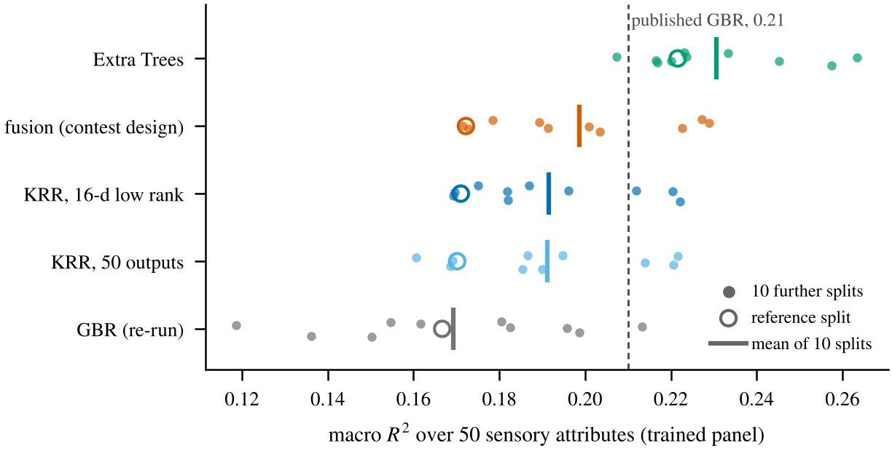
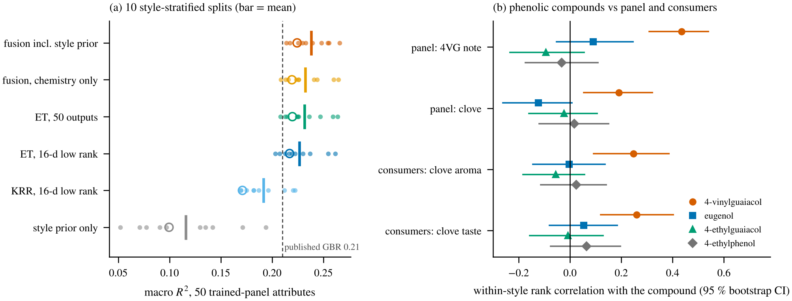

# From beer chemistry to sensory profiles: prediction, key compounds, conditional generation and style transfer

**Competition:** 2026 MathorCup Mathematical Application Challenge — Big Data track, Problem A (啤酒酿造化合物分析与啤酒风味预测) · entry MCB2600347

**Read first:** [`paper/MCB2600347_paper_zh_extended.pdf`](paper/MCB2600347_paper_zh_extended.pdf) — the extended edition: the submitted document, unchanged (Part I, in Chinese), followed by the post-competition extensions written up in English as Part II (pages E-1 to E-3). The file as submitted, `paper/MCB2600347_paper_zh.pdf`, is kept as handed in.

250 beers, 231 chemical fields and 50 trained-panel sensory attributes. The paper links four models:
sensory prediction, stability of key-compound rankings, style-conditional generation of chemical
profiles, and margin-controlled sparse style transfer.

| Task | Method | Key result (paper) |
|---|---|---|
| Sensory prediction | six-model baseline (ridge, rank-ridge, RBF kernel ridge, PLS, Extra Trees, random forest) + dual-representation TabICL models (16-d low-rank target branch and 50 independent outputs) combined by grouped convex fusion with weights from inner out-of-fold predictions; beer-level grouped hold-out | macro $`R^2`$ 0.29897 (all 50) and 0.25326 (core 30); core-30 RMSE 0.81202 → 0.68495, seven-level RPS 0.11689 → 0.11007 |
| Key compounds | co-variation modules, within-style regression, stratified resampling | 4-vinylguaiacol stays in the within-style Top-3 for phenolic aroma in 100 % of resamples; lactic acid's overall rank does not survive within styles |
| Conditional generation | interval copula on low-dimensional truncated margins + conditional Gaussian completion; 100 profiles for each of 22 styles with DMS / diacetyl conditions | energy score on 29 held-out beers 0.62529 → 0.61572 |
| Style transfer | classification-margin, target-distance, defect and edit-budget constraints | 100 refit scenarios, ≤ 100 edits: both margin settings cover 11 beers; joint source rate 90.09 % vs 33.64 % |

The paper (Chinese, 73 pages) is in `paper/`; the support material (73-stage pipeline, audits, figures;
large arrays and pretrained-model caches removed) is in `support_material/`.

## Post-competition extension

### E1 — the fusion design under the published reference protocol

The contest data are drawn from the public study of Schreurs et al., *Nature Communications* 15, 2368
(2024) (Zenodo 10653704, CC BY 4.0), whose best model — multi-output gradient boosting — reports a
trained-panel $`R^2`$ of 0.21 on a 70/30 split stratified by beer style. The contest paper's numbers use a
different protocol (grouped hold-out) and TabICL foundation models, so they cannot be placed next to 0.21
directly. Here the **fusion design itself** was re-implemented without foundation models (RBF kernel ridge
in both branches, convex weights per attribute group from inner 3-fold OOF predictions) and scored under
the reference study's own protocol: its split (`random_state=0`) plus 10 further stratified splits.
Script: `extension/e1_published_protocol.py`; data: the study's supplementary workbook in
`data/external/`.

| Model (macro $`R^2`$ over 50 attributes) | Reference split | Mean of 10 splits (sd) |
|---|---:|---:|
| GBR, reference study (published, tuned) | 0.21 | — |
| GBR, re-run (fixed hyper-parameters) | 0.167 | 0.169 (0.030) |
| KRR-RBF, 50 independent outputs | 0.170 | 0.191 (0.022) |
| KRR-RBF, 16-d low-rank targets | 0.171 | 0.192 (0.020) |
| **Grouped convex fusion (contest design)** | 0.172 | **0.199 (0.022)** |
| Extra Trees | **0.222** | **0.231 (0.019)** |



* The fusion step transfers: it improves on the better of its two branches in the mean (+0.004 macro
  $`R^2`$, the same order as the +0.008–0.019 gain reported in the paper) and beats the re-run GBR in 9 of
  10 splits (+0.029).
* A well-regularised Extra Trees model is the strongest learner on this protocol and exceeds the
  published GBR on the reference split (0.222 vs 0.21); the natural next step is to use it, rather than
  kernel ridge, as a branch learner in the fusion.
* Linear ridge is unstable under macro $`R^2`$ (single attributes with near-constant test values produce very
  negative $`R^2`$), which mirrors the large negative linear-model entries in the reference study's
  Supplementary Table S3; macro $`R^2`$ alone is a fragile headline metric for 50-dimensional sensory
  prediction.

### E2 — strong branches, beer style, and an outside check of the key compound

E1 suggested feeding the fusion with stronger learners. E2 does so under the same protocol, with four
branches: Extra Trees on the 50 attributes, Extra Trees on the 16-dimensional low-rank targets, kernel ridge
on the same targets, and a *style prior* (the training mean of each attribute within the beer's style).
Simplex weights per attribute group are fitted on inner out-of-fold predictions of the training part only.
Script: `extension/e2_strong_fusion.py`.

| Model (macro $`R^2`$, 50 attributes) | Reference split | Mean of 10 splits (sd) |
|---|---:|---:|
| Style prior only | 0.100 | 0.116 (0.046) |
| Kernel ridge, 16-d low rank | 0.171 | 0.192 (0.020) |
| Extra Trees, 16-d low rank | 0.217 | 0.226 (0.020) |
| Extra Trees, 50 outputs | 0.220 | 0.232 (0.019) |
| Fusion of the three chemistry branches | 0.219 | 0.232 (0.019) |
| **Fusion including the style prior** | **0.224** | **0.238 (0.017)** |
| *Published GBR (tuned)* | *0.21* | — |

In E2 every branch is fitted to standardised targets, so a multi-output tree weights the 50 attributes
equally; with raw targets (E1) the same Extra Trees configuration scores 0.222 / 0.231.

* **A new best under the published protocol.** Fusion with the style prior beats Extra Trees by +0.0065
  (s.e. 0.0020) and wins in 9 of 10 splits. It beats the re-run GBR in all 10 (+0.069).
* **With strong branches, the gain comes from style, not from mixing learners.** The chemistry-only fusion
  ties Extra Trees, and adding the style prior adds +0.006 (9 of 10 splits). Style alone reaches half of
  the best macro $`R^2`$ and receives 22 % of the fusion weight on average (27–28 % for aroma and flavour
  groups, 16–17 % for the rest). It is never sufficient, though: the fusion beats the style prior on all 50
  attributes.
* **The contest's key compound holds up outside its training population.** The paper found
  4-vinylguaiacol in the within-style Top 3 for the panel's phenolic note in 100 % of resamples. Within
  styles its concentration is rank-correlated with that panel note (ρ = 0.43 [0.31, 0.54]). It is also
  correlated with what an independent population writes: RateBeer consumers' clove descriptors in the
  study's Supplementary File S7 (aroma 0.25 [0.09, 0.39], taste 0.26 [0.12, 0.40]). The other clove/smoky
  phenols measured (eugenol, 4-ethylguaiacol, 4-ethylphenol) show no within-style association with any of
  the four targets: all twelve intervals include zero, the closest to excluding it being eugenol vs the
  panel's clove note, −0.12 [−0.26, 0.01].



*Fig. E2 — (a) Macro $`R^2`$ on 10 style-stratified splits (dots; open circle = reference split; bar = mean).
(b) Within-style rank correlation of four phenolic compounds with the trained panel's 4VG and clove notes and
with consumers' clove descriptors (2 000 bootstrap resamples).*

## Reproduce

```bash
pip install numpy pandas scipy scikit-learn openpyxl
python extension/e1_published_protocol.py           # ~40 min on one CPU (11 splits × 6 models)
python extension/e2_figure.py                       # figure from results/extension/e1_split_scores.csv
python extension/e2_strong_fusion.py                # ~25 min on two cores (11 splits, inner 3-fold fusion)
python extension/e3_figure_e2.py
# contest pipeline: see support_material/research/README.md (requires the eight contest attachments)
```

## Licence

Code: MIT. Paper and figures: CC BY 4.0. Reference-study data: CC BY 4.0 (Schreurs et al., 2024).
