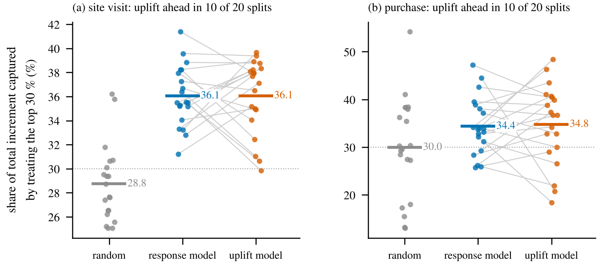
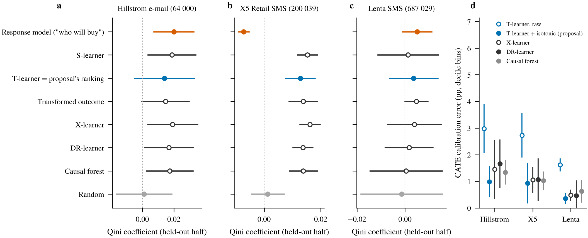

# "Who buys because of the coupon?" — causal uplift budgeting for local-services coupons

**Competition:** 6th Meituan Business Analytics Elite Contest (第6届美团商业分析精英大赛), business topic 14 · entry 1514

**Read first:** [`paper/who_buys_because_of_the_coupon_proposal_zh_extended.pdf`](paper/who_buys_because_of_the_coupon_proposal_zh_extended.pdf) — the extended edition: the submitted document, unchanged (Part I, in Chinese), followed by the post-competition extensions written up in English as Part II (pages E-1 to E-4). The file as submitted, `paper/who_buys_because_of_the_coupon_proposal_zh.pdf`, is kept as handed in.

The proposal reframes coupon-budget allocation from conversion prediction ("who will buy") to causal
increment estimation ("who buys *because of* the coupon"). Its framework combines an IPTW-weighted
T-learner with isotonic calibration of the conditional average treatment effect (CATE), behavioural
economics (Fehr–Schmidt inequity aversion as a fairness guard for high-value existing customers) and a
budget-constrained allocation over time × city-tier windows. Because only 950 orders and 478 behaviour
sequences were available, the quantitative evaluation used a 100 000-user digital twin calibrated to the
quantiles of 197 real users and to effect sizes from the literature (KS = 0.013).

**Reported (on the digital twin, 400 k CNY/day budget):** 67 % of subsidies go to customers who would
buy anyway; re-targeting them to late-night × lower-tier windows with 3.3× CATE efficiency releases 26.0 %
more incremental orders than uniform allocation, at a 0.4 % efficiency cost for protecting high-value
existing customers. The full proposal (Chinese, 15 pages) is in `paper/`, together with its extended edition.

## Post-competition extension E1: does the thesis hold on a real randomised experiment?

The digital twin builds in a "persuadable" segment (≈3 % base conversion rising above 30 % with a
coupon), which is exactly the structure that makes uplift targeting superior. The thesis was therefore
tested where treatment is randomised and nothing is simulated: the MineThatData e-mail experiment
(Hillstrom, 2008; 64 000 customers randomly assigned to a men's e-mail, a women's e-mail or no e-mail;
2-week visit and conversion). Policies were learned on a random half and evaluated on the other half with
Qini curves over 20 repetitions. Script: `extension/e1_hillstrom_rct.py` (downloads the data from the
author's site; the data are not redistributed).

| Policy (outcome: visit) | Share of total increment captured by treating the top 30 % | Qini area |
|---|---:|---:|
| Random | 28.8 % ± 3.2 | −0.0002 |
| Response model — "who will buy" | 36.1 % ± 2.5 | 0.0026 |
| T-learner uplift — "who buys because of it" | 36.1 % ± 3.1 | 0.0025 |
| Uplift + IPTW isotonic calibration (proposal) | 36.1 % ± 3.1 | 0.0025 |



* Both learned policies beat random targeting by about 7 points, but **uplift targeting does not beat
  response targeting** on this experiment (paired: better in 10 of 20 splits, mean difference +0.02 pp; the
  conversion outcome gives the same picture).
* This is not because the data lack persuadables: the estimated baseline and uplift are negatively rank-
  correlated (Spearman −0.21) and the two top-30 % lists overlap only 46 %. With ~21 000 treated and
  ~10 700 control customers per training half, the T-learner's uplift estimates are too noisy for their
  different ranking to translate into more incremental visits.
* Isotonic calibration is monotone, so it improves the *scale* of the CATE (needed for budget decisions in
  money) but cannot change the ranking; its value lies in the allocation step, not in targeting.

The proposal's 26 % gain is therefore conditional on the simulated effect heterogeneity. A deployment
case needs a randomised holdout of sufficient size, a lower-variance uplift learner (DR-/X-learner, causal
forest) and pre-registered Qini comparisons against the incumbent response model.

## Post-competition extension E2: the learner or the campaign? Seven targeting rules on three randomised campaigns

E1 left two explanations open. The T-learner may be too noisy, so that a lower-variance uplift learner
would beat response targeting, or the Hillstrom campaign may simply not reward uplift targeting. E2
separates the two by running the established uplift learners, with identical gradient-boosting base
learners, on three public randomised campaigns that bracket the proposal's setting (a marketing contact
followed by a purchase or a visit):

| Campaign | Customers | Treated | Outcome | Average effect (control rate) |
|---|---:|---:|---|---:|
| Hillstrom e-mail (MineThatData, 2008) | 64 000 | 2/3 | website visit within two weeks | +6.1 pp (10.6 %) |
| X5 RetailHero SMS (2019) | 200 039 | 1/2 | purchase after the campaign; 23 features built from 45.8 M pre-campaign receipt lines | +3.3 pp (60.3 %) |
| Lenta SMS (2020) | 687 029 | 3/4 | store visit; 191 customer features | +0.75 pp (10.3 %) |

The rules are a response model ("who will buy"), the S-, T-, transformed-outcome, X- (Künzel et al. 2019)
and DR-learners (Kennedy 2023), and a causal forest (econml). The T-learner is the proposal's ranking: its
isotonic calibration is monotone and does not change the order. Each rule is fitted on one half of a
stratified 50/50 split and scored on the other half (20, 10 and 5 splits) by the Qini coefficient, sklift's
normalised Qini area; E1 reported the unnormalised area. Paired differences carry 95 % intervals from the
corrected resampled t-test (Nadeau & Bengio 2003), which accounts for the overlap between repeated splits.
Scripts: `extension/e2_uplift_benchmark.py` (downloads the data at run time; nothing is redistributed) and
`extension/e3_summarise_e2.py`.

| Qini coefficient (mean over splits) | Hillstrom | X5 | Lenta |
|---|---:|---:|---:|
| Response model ("who will buy") | **0.0200** | −0.0072 | **0.0051** |
| S-learner | 0.0188 | 0.0153 | 0.0013 |
| T-learner (the proposal's ranking) | 0.0141 | 0.0128 | 0.0036 |
| Transformed outcome | 0.0147 | 0.0138 | 0.0047 |
| X-learner | 0.0192 | **0.0162** | 0.0039 |
| DR-learner | 0.0169 | 0.0137 | 0.0017 |
| Causal forest | 0.0174 | 0.0138 | 0.0004 |
| Random | 0.0011 | 0.0013 | −0.0014 |
| Share of the total increment captured by the top 30 % (response / best uplift learner) | 35 % / 35 % | 15 % / 61 % | 41 % / 45 % |
| CATE calibration error, T-learner raw → + isotonic (pp) | 3.0 → 1.0 | 2.7 → 0.9 | 1.6 → 0.4 |



*Fig. E2 — (a–c) Qini coefficient of each targeting rule on the held-out halves (mean and corrected 95 %
interval). (d) Calibration error of the predicted uplift in decile bins; the proposal's isotonic step is the
filled blue marker.*

* **Whether uplift targeting pays depends on the campaign, not on the learner.** On X5 the customers most
  likely to buy are the ones least moved by the SMS. Response targeting does worse than random there, and its
  top 30 % holds only 15 % of the incremental purchases. Every uplift learner beats it in all 10 splits
  (X-learner +0.023 [0.019, 0.028]). On Hillstrom and Lenta the response model ranks at least as well as the
  best uplift learner (X-learner −0.0007 [−0.0211, +0.0196]; transformed outcome −0.0004 [−0.0077, +0.0070]).
* **The T-learner is a weak uplift ranker.** The X-learner ranks best on Hillstrom and X5 and beats the
  T-learner in 17 of 20 and 9 of 10 splits. The gains (+0.005 and +0.003) are not significant on their own.
* **The proposal's calibration step does its job.** Isotonic regression of the IPTW-transformed outcome on
  the T-learner's prediction cuts the calibration error from 3.0 to 1.0, 2.7 to 0.9 and 1.6 to 0.4 pp, in
  every split of every campaign (Hillstrom −2.0 pp [−2.9, −1.1]). The calibrated estimate is also better
  calibrated than the X-learner, the DR-learner and the causal forest on all three campaigns, and calibration
  is what a budget allocation stated in money needs.

The two halves of the framework therefore deserve different verdicts. Calibrated effect estimates for the
budget step hold up on all three experiments. Targeting by uplift pays only where likely buyers and
persuadable buyers differ, as at X5. Before deployment this must be checked on a randomised holdout against
the incumbent response model, with an X-learner rather than a T-learner as the ranker. *Boundary:* three
campaigns from retail and e-commerce, not local-services coupons; Lenta's small average effect leaves all
of its rules within noise of each other.

## Reproduce

```bash
pip install numpy pandas scikit-learn
python extension/e1_hillstrom_rct.py    # downloads the public Hillstrom data on first run (not redistributed)
python extension/e2_figure.py
pip install scikit-uplift econml polars pyarrow scipy
python extension/e2_uplift_benchmark.py hillstrom x5 lenta   # E2: downloads ~0.8 GB, about 3 h on two cores
python extension/e3_summarise_e2.py
python extension/e4_figure_e2.py
```

## Licence

Code: MIT. Proposal document: CC BY 4.0.
