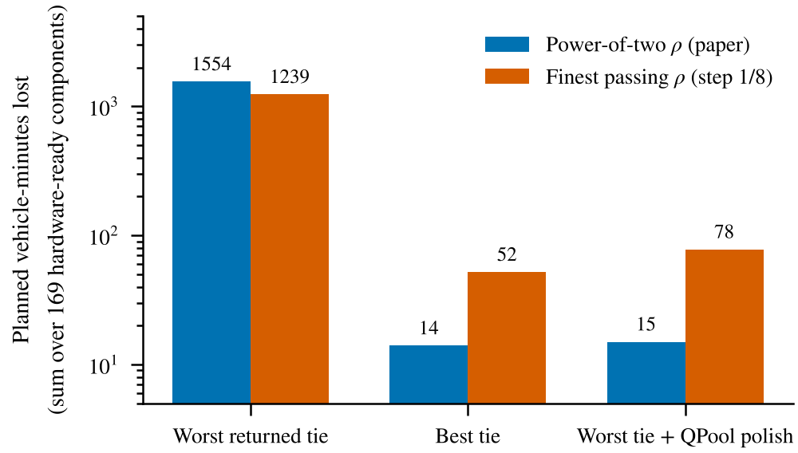
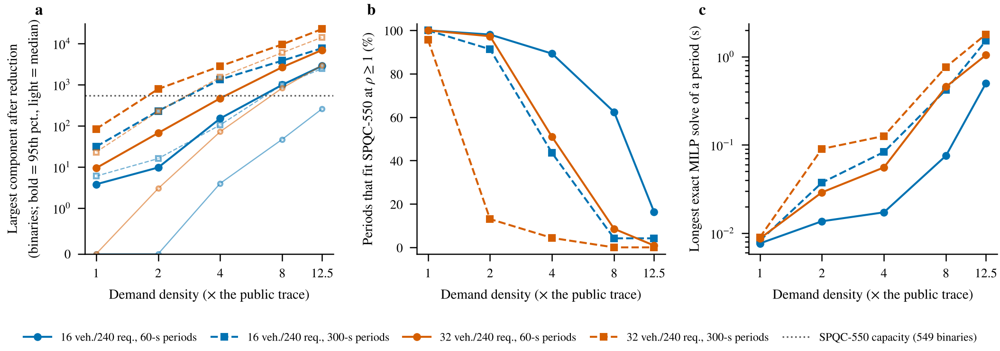

# QPool — quantum–classical co-optimisation for dynamic ride-pooling

**Competition:** 1st Quantum Computing Application Scenario Challenge (首届量子计算应用场景挑战赛), university track, 2026 · entry *Operations Research Center* (LZJS0013)

**Read first:** [`paper/QPool_report_zh_extended.pdf`](paper/QPool_report_zh_extended.pdf) — the extended edition: the submitted document, unchanged (Part I, in Chinese), followed by the post-competition extensions written up in English as Part II (pages E-1 to E-3). The file as submitted, `paper/QPool_report_zh.pdf`, is kept as handed in.
**Hardware:** QBoson SPQC-550 coherent Ising machine (550 spins, signed 8-bit couplings)

QPool turns each dispatch period of a dynamic ride-pooling system into a weighted conflict-graph
packing problem whose decision units are *already feasible* vehicle itineraries. The packing problem is
encoded as a QUBO with a locally sufficient penalty, reduced exactly, quantised to the 8-bit coefficient
range of the SPQC-550, solved on the device, and decoded back into vehicle–request assignments. A
classical post-processing step recovers original-cost differences that quantisation erases.

## Problem in brief

Requests arrive continuously; a fleet with capacity, maximum-wait and maximum-detour limits must decide
every 60 s or 300 s which requests to accept, which vehicle serves them and in which pick-up/drop-off
order, without breaking commitments already made to on-board or assigned passengers. The quantum
device is only useful if (i) the combinatorial core fits its spin count and coefficient precision and (ii)
its answers translate into executable, costed vehicle plans.

## Method

| Stage | What it does | Code |
|---|---|---|
| Feasible-trip generation | single-request insertion, then width-limited growth to 2- and 3-request trips; capacity, wait, detour and route-prefix commitments enforced | `src/qpool/replay.py` |
| Conflict-graph packing | one binary per trip; edges for shared vehicle or shared request; weight $w_f=\lvert S_f\rvert-\lambda\,\Delta T_f/T_0$ | `src/qpool/qubo.py` |
| Local sufficient penalty | $P_{fg}=\min(w_f,w_g)+\eta$ makes every infeasible state one-flip improvable, so the ground state is feasible and penalty magnitudes stay local | `src/qpool/qubo.py` |
| Exact reduction | positive isolated vertices fixed; closed-neighbourhood dominance $N[u]\subseteq N[v],\ w_u\ge w_v$ removes $v$ | `src/qpool/competition.py` |
| Precision fitting | weights rounded at resolution $\rho$ (power-of-two ladder), Ising matrix rebuilt and checked against 550 spins / int8 | `src/qpool/competition.py` |
| Equal-energy polish | among returned quantised optima, choose by original utility, then 1-/2-swap moves that keep the quantised reward and raise the original utility | `src/qpool/competition.py` |
| Hardware report audit | parses the six SPQC-550 task reports, re-computes every Ising energy, feasibility and business utility | `src/qpool/provider_reports.py` |

## Results reported in the competition paper (re-verified)

All 177 unit tests pass and the six hardware reports re-verify (`python -m pytest -q`).

| Evidence | Result |
|---|---|
| Six frozen SPQC-550 tasks (11–82 spins) | device minimum Hamiltonian equals the known optimum of every uploaded quantised model |
| Equal-energy polish vs. first device answer | planned incremental driving −50.0 % (A01), −41.3 % (A02), −10.7 % (A04); 561 → 505 vehicle-minutes over six tasks |
| 24-condition closed-loop replay (Sioux Falls, 240 requests) | completion 73.229 % vs. 73.281 % for HiGHS MILP (−0.052 pp); zero capacity, wait or detour violations |

## Post-competition extension E1: how far does the 8-bit device carry real dispatch?

The paper evaluates six frozen periods. Here every frozen period recorded during the classical replays
(**435 periods**, 8 fleet-size × period conditions) is pushed through the same compilation pipeline, and the
quantisation effect is measured **exactly** with MILP: for each hardware-ready component we compute the
original optimum, the quantised optimum, and the full range of original utility over *all* quantised-optimal
solutions — i.e. the best and worst answer an ideal Ising solver could legitimately return.
Script: `extension/e1_precision_audit.py`; outputs in `results/extension/`.

**Findings**

1. **Most periods need no solver at all.** Exact reduction alone settles 295 of 435 periods (68 %); the
   median number of free binaries after reduction is 0. The combinatorial core that reaches the device is
   small (median 5 binaries per component, maximum 138 at a usable precision).
2. **Spin count is not the binding constraint; precision is.** All 178 non-trivial components have ≤ 257
   binaries, well under 549. The int8 range binds instead: 9 components (all from 32- and 48-vehicle runs)
   fit only at $\rho<1$, where most rounded weights collapse to zero. Whole periods compile at $\rho\ge1$
   in 100 % of periods for 8–16 vehicles, 100 % / 96 % for 32 vehicles (60 s / 300 s) and 98 % / 74 % for
   48 vehicles; the remainder require the conditional-neighbourhood mode the paper uses for A05/A06.
3. **Quantisation rarely removes the optimum but often creates ties.** 40 % of hardware-ready components
   have quantised ties with different original costs. The best tie equals the original optimum in 97.6 %
   of components, whereas the worst admissible tie loses 1 554 planned vehicle-minutes in total.
4. **The classical polish is what makes the device output usable.** Started from the *worst* admissible
   tie, the equal-energy polish reaches the best tie in 99.4 % of components, cutting the total loss from
   1 554 to 15 vehicle-minutes. The a-priori bound $K/\rho$ of the paper is a median 7.8× above the
   realised worst-tie loss.
5. **Finer precision is not monotonically better.** Searching the finest passing $\rho$ on a 1/8 grid
   (instead of powers of two) reduces the worst-tie loss (1 554 → 1 239) but *increases* the after-polish
   loss (15 → 78): re-rounding can push the original optimum out of the quantised tie set, which no
   post-processing can undo. Paired by component, finer $\rho$ is better in 4, worse in 7 and equal in
   158 cases after polishing. With a polish step, the property to protect is *tie-set coverage of the
   original optimum*, not the rounding error alone.



*Fig. E1 — Planned vehicle-minutes lost to 8-bit quantisation, summed over the 169 hardware-ready
components of 435 frozen dispatch periods.*

## Post-competition extension E2: does the dispatch core outgrow the device when demand gets denser?

E1 works at the paper's demand level: 240 requests of the public Sioux Falls trace in about 1.9 hours. A city
is denser. E2 replays the same classical dispatch at k = 1, 2, 4, 8 and 12.5 times that density, using the
first 240 k requests of the trace with arrival times divided by k so that the horizon stays at about
1.9 hours. The fleet scales with demand (16 k or 32 k vehicles) and dispatch periods last 60 s or 300 s,
giving 20 runs and 1 331 frozen periods. Every period is analysed as in E1: exact
reduction, connected components, whether every component fits the SPQC-550 model at a usable precision
(ρ ≥ 1 on the paper's power-of-two ladder), and the exact optimum and LP bound computed with HiGHS.
Script: `extension/e3_density_scaling.py`.

The submission's reduction routine rescans the whole period after every removal. One period of 972
candidates takes it 34 s, and the densest runs have periods of more than 20 000 candidates. E2 therefore
runs an event-driven implementation of the same rule. It keeps, for every adjacent pair, the number of closed neighbours of one
vertex that the other lacks, so that domination is a zero count. It removes the same vertices in the same
order. The kept, fixed and removed sets were asserted equal to those of the submission's routine on all
907 periods with at most 600 candidates and on 300 random instances; on the 972-candidate period it
takes 0.07 s.

Ranges over the four fleet × period configurations at each density:

| Demand density k (× public trace) | 1 | 2 | 4 | 8 | 12.5 |
|---|---:|---:|---:|---:|---:|
| Requests / vehicles | 240 / 16–32 | 480 / 32–64 | 960 / 64–128 | 1920 / 128–256 | 3000 / 200–400 |
| Periods settled by reduction alone | 4–91 % | 4–69 % | 0–29 % | 0–1 % | 0–4 % |
| Largest component after reduction (binaries) | 25–167 | 109–984 | 412–2 929 | 1 404–11 126 | 5 317–24 458 |
| Periods that fit SPQC-550 at ρ ≥ 1 | 96–100 % | 13–98 % | 4–89 % | 0–62 % | 0–16 % |
| Longest exact MILP solve of a period (s) | 0.01 | 0.01–0.09 | 0.02–0.13 | 0.08–0.76 | 0.50–1.79 |

* **The device carries the paper's setting, and little beyond it.** At k = 1 every component of almost every
  period fits. From k = 4 on, the largest component after reduction reaches thousands of binaries against
  549 usable spins. With the larger fleet, 51 % (k = 4) and 9 % (k = 8) of the 60-s periods still fit, and
  at most 4 % of the 300-s periods.
* **Exact reduction loses its grip as well.** It settles 70–91 % of the 60-s periods at k = 1 but at most 4 %
  from k = 8 on. On average it removes 83 % of a period's candidates at k = 1 and 35 % at k = 12.5.
* **A classical solver does not notice the growth.** HiGHS proves the optimum of every one of the
  1 331 periods, the slowest in 1.8 s. The LP relaxation is integral in 75 % of the
  periods and never more than 7.5 % above the optimum.

At city-scale densities the binding limit of the quantum route is therefore spin capacity, reached long
before the dispatch problem becomes hard for an exact classical solver. Decomposition into device-sized
neighbourhoods, the mode the paper uses for its two largest snapshots, would have to carry almost the whole
load. *Boundary:* one seed per configuration; demand is densified by compressing the arrival times of a
single public trace rather than observed at higher volume.



*Fig. E2 — (a) Largest connected component after exact reduction per period (bold: 95th percentile,
light: median) against demand density; dotted line: SPQC-550 capacity. (b) Share of periods whose every
component fits the device at ρ ≥ 1. (c) Longest exact MILP solve of a period.*

## Reproduce

```bash
python -m pip install -r requirements.txt && python -m pip install -e .
python -m pytest -q                                        # 177 tests, hardware-report re-verification
python scripts/import_provider_reports.py --output results/stage3/recheck
python extension/e1_precision_audit.py                     # ~20 s
python extension/e2_figures.py
python scripts/fetch_example_data.py --accept-source-license --prefix 3000 --out data/full_example   # E2 input, see licence below
python extension/e3_density_scaling.py                     # E2, about 1.5 h on two cores, resumable
python extension/e4_figure_density.py
```

The closed-loop replay needs the public Sioux Falls example of
[BUILTNYU/ridepooling](https://github.com/BUILTNYU/ridepooling) (pinned commit, non-commercial research
licence). It is **not redistributed here**; `scripts/fetch_example_data.py --accept-source-license` downloads
and hash-checks it after you have read the upstream licence. The official Kaiwu SDK simulated-annealing
baseline requires a licensed SDK and was not run.

## Repository layout

```
src/qpool/            model, reduction, compilation, solvers, replay, report parsing
scripts/              replay drivers, upload builders, report import
tests/                177 unit/integration tests
upload/               Ising matrices exactly as uploaded to SPQC-550
results/stage2/       classical replays, frozen snapshots, application batch
results/stage3/       six raw device reports (PDF) and their re-verification
results/extension/    post-competition precision audit (E1) and density scaling (E2)
extension/            audit, density-scaling and figure scripts
paper/                competition report (Chinese) as submitted, and its extended edition with Part II (*_extended.pdf)
docs/                 original submission README (Chinese)
```

## Limitations

The extensions audit frozen periods from classical replays (one seed per condition); they measure the
quantised model, not device noise. Device evidence remains the six tasks reported in the paper. The
Sioux Falls trace is a public example, not observed service demand.

## Licence

Code: MIT (see `LICENSE`). Paper and figures: CC BY 4.0. Third-party data are not included.
