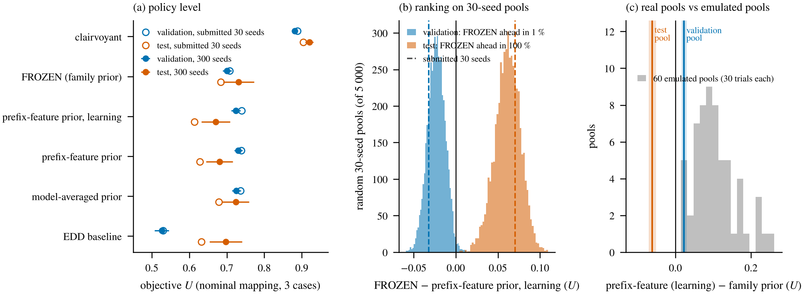
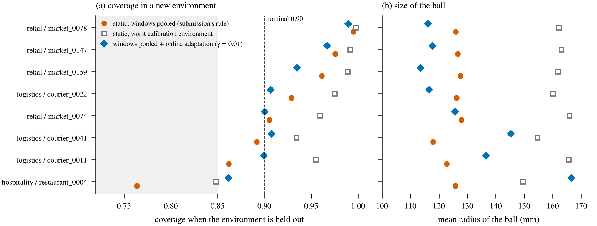

# From egocentric hand records to restocking decisions: calibrated state prediction, re-observation and reservation scheduling

**Competition:** 12th ShuWei Cup (数维杯) National College Student Mathematical Modeling Challenge, autumn 2026, Problem C · entry SWBMCM2639496

**Read first:** [`paper/CSWBMCM2639496_extended.pdf`](paper/CSWBMCM2639496_extended.pdf) — the extended edition: the submitted document, unchanged (Part I), followed by the post-competition extensions written up as Part II (pages E-1 to E-6). The file as submitted, `paper/CSWBMCM2639496.pdf`, is kept as handed in.

Restocking in an unmanned store has to be planned from observations that are intermittently unreliable.
Starting from 69 raw egocentric demonstration records (66 070 timestamps, 24 environments in the EgoDemo,
EgoPro and EgoStandard datasets), the work builds one chain from data audit to scheduling decisions. Every
model is fitted on 16 training environments, selected on 4 validation environments and evaluated on 4 test
environments. This release adds a portability fix, a clean-room rerun and a post-contest study of how much a
30-seed evaluation of the Problem 3 policy can be trusted.

## Method and reported results

| Problem | Model | Reported evidence (test environments) |
|---|---|---|
| 1 · state and reliability | palm centre in the head frame plus a four-level motion phase (HMM); structural state-space model (drifting anchor + damped spring, 7 parameters, Kalman filter); two-state Markov reliability chain with a logistic onset hazard | prediction error 9.0 / 50.7 / 83.5 mm at 0.1 / 0.5 / 3 s (hold-last: 16.2 / 58.4 / 112.8 mm); reliability AUC 0.89 |
| 2 · re-observation | propagation through missing windows, split-conformal calibration of the prediction ball, trigger rule checked against an exact dynamic programme | coverage of the 90 % ball restored from 0.78 to 0.90; 50 mm tolerance held for 0.20 s; 12 instead of 22 requests per 3-s window; doubled radius covers all 35 natural gaps |
| 3 · scheduling | stochastic sequential decision model; rollout over a priority index with a hierarchical log-normal duration model; reservation at the predictive median; paid reviews priced by value of information | weighted on-time rate 0.93 / 0.85 / 0.80 in cases S1–S3 (floor 0.50), no infeasible command; objective 0.684 against 0.632 for earliest due date (EDD) |

The decision rule of Problem 3 (policy `FROZEN`, family-level duration prior) was chosen among six belief
configurations by a one-standard-error rule whose standard error is the pool-to-pool spread measured on 60
emulated pools of training environments (`code/p3_pooltransfer.py`). Details of every step are in
`SUPPORT_PACKAGE.md`, the README of the submitted support material.

## Reproduction and the post-contest fix

`python code/run_all.py --procs 2` reruns the whole pipeline from the official data (16–18 minutes on two
cores). In the documented layout (support folder next to the official data folder) two figure and table
programs failed, because `fig_mechanism.py` and `make_tables.py` looked for the task files only in
`<package>/tasks/` instead of using the task-folder resolution of `common.py`. Both now import `TASK_DIR` from
`common.py`; no computation changed. With this fix a clean rerun reproduced all 78 judged result files cell by
cell (964 058 numeric cells, largest relative difference 0.0; `results/extension/repro_postcontest.json`); four
further files record run times and are listed but not judged. That rerun
used the same Linux library versions as the original run (`results/extension/environment_postcontest.json`); the
cross-platform check is the Windows rerun recorded with the submission in `results/repro_report.json` (largest relative difference 3e-5).

## Post-contest extension: what does a 30-seed evaluation of Problem 3 tell?

The organisers score Problem 3 on 30 undisclosed seeds. The submission reports 30 public validation seeds and 30
self-chosen test seeds, and its two pools disagree: on validation the prefix-feature priors beat `FROZEN`, on test
`FROZEN` wins. The extension replays `FROZEN`, the three learnt alternatives, the EDD baseline and the clairvoyant
benchmark on 300 seeds that were never used before (2026130000–2026130299), with the submission's own command
`p3_run.py custom` (300 seeds × 3 cases × 5 duration mappings = 4 500 trials per policy and pool; 54 000 trials,
no invalid action). Replays are deterministic and independent of which policies share a batch: `FROZEN` replayed
alone on the public seeds reproduces the submitted trials exactly (`results/extension/e1_batch_invariance_check.json`).
Seeds are the independent unit, because all policies see the same jobs for a seed. Numbers below use the nominal
duration mapping, on which the headline objective, the selection rule and the service floor are defined; the mean
over all five mappings (`results/extension/e1_summary.json`) gives the same signs.

| Objective $U$, nominal mapping | Validation pool, 300 seeds [95 % CI] | submitted 30 seeds | Test pool, 300 seeds [95 % CI] | submitted 30 seeds |
|---|---:|---:|---:|---:|
| `FROZEN` (family prior) | 0.701 [0.689, 0.713] | 0.707 | 0.731 [0.690, 0.772] | 0.684 |
| prefix-feature prior | 0.731 [0.720, 0.741] | 0.739 | 0.681 [0.645, 0.716] | 0.628 |
| prefix-feature prior, on-line learning | 0.724 [0.711, 0.737] | 0.739 | 0.670 [0.632, 0.709] | 0.614 |
| model-averaged prior | 0.725 [0.714, 0.737] | 0.736 | 0.724 [0.688, 0.759] | 0.679 |
| EDD baseline | 0.527 [0.507, 0.546] | 0.530 | 0.698 [0.654, 0.741] | 0.632 |
| clairvoyant (all durations known) | 0.881 [0.874, 0.889] | 0.889 | 0.920 [0.910, 0.931] | 0.904 |

**The reversal is a property of the environment pools, not of the seeds.** Paired over 300 seeds, `FROZEN` trails
the prefix-feature prior by 0.030 [0.024, 0.036] on the validation pool and leads it by 0.051 [0.041, 0.061] on
the test pool; the swing of 0.081 has a seed-noise standard error of 0.006. On random 30-seed pools drawn from the
same environments the sign of this comparison almost never changes (`FROZEN` ahead in 0.02 % of validation pools
and 99.8 % of test pools), whereas the difference between the two environment pools is 5.2 to 8.5 times the
30-seed noise (standard deviation of the paired difference 0.010–0.016 over 30 seeds). This confirms the premise
of the pool-level selection rule: pool-to-pool variation, not trial noise, sets the uncertainty of a choice.

**One test environment explains most of the reversal.** The submission's held-out duration results already show that the
0.2-s prefix features lower the log-duration error on the validation environments (0.43 against 0.56 for the
family prior) but raise it on the test environments (0.52 against 0.37), mostly in
`logistics_x_courier_station_0041` (21 of 62 test units; 0.70 against 0.25, the prefix model over-predicting
durations there by a factor of about 1.7 in geometric mean). Replaying the priors on the same 300 seeds with that environment removed from the
test pool (`extension/e3_attribution.py`; policies never read the source pools) moves the gap of the
prefix-feature prior from −0.051 to +0.001 [−0.009, 0.011] and that of the learning variant from −0.061 to −0.013
[−0.023, −0.003]. Across the trials of the full test pool the gap also falls with the share of jobs drawn from that
environment (slope −0.14 [−0.25, −0.03] per unit share for the static prior).

**The emulated pools did not predict the test outcome.** On the 60 emulated pools that the rule used, the
prefix-feature priors beat the family prior on average (+0.058 for the static, +0.105 for the learning variant;
the learning variant wins in all 60 pools). The validation pool sits at the median (static) and the 5th percentile (learning)
of that distribution, the test pool below 59 of 60 (static) and all 60 (learning) emulated pools. The rule chose the family prior because it is the
simplest configuration within one pool-level standard deviation of the best, and on this test pool that choice paid
off; the emulation itself pointed the other way. In hindsight, the model-averaged prior is within 0.008 of the best
prior on both real pools (largest regret 0.008, against 0.030 for `FROZEN` and 0.051–0.061 for the prefix-feature
priors; over all mappings 0.019 against 0.025), which suggests that averaging the two duration experts is the safer
design when a test environment may break the prefix features.

**Levels and the service floor.** The 30 self-chosen test seeds were an unfavourable draw: every policy's test mean
lies at the 17th–23rd percentile of random 30-seed pools, so the submitted test levels understate the 300-seed
levels by 0.02 (clairvoyant) to 0.07 (EDD), about 0.05 for the learnt priors. The gain of `FROZEN` over EDD on the test pool is +0.034 [0.025, 0.043] rather than the
submitted +0.052, and `FROZEN` is ahead on 99.6 % of random 30-seed pools; on validation the gain is +0.174
[0.163, 0.185]. The distance to the clairvoyant benchmark is 0.181 (validation) and 0.189 (test). The weighted
on-time rate of `FROZEN` is 0.98 / 0.85 / 0.75 (validation) and 0.95 / 0.87 / 0.84 (test) in S1 / S2 / S3, and none
of the 5 000 random 30-seed pools falls below the 0.50 floor (1 % quantile in the weakest case 0.70). The EDD
baseline would fail the floor in case S3 of the validation pool on 23 % of 30-seed pools.

**Protocol note.** The pool-level rule was adopted after the test pool had been inspected under an earlier
trial-level one-standard-error rule, which selects a prefix-feature prior. The submitted test comparison is
therefore not a blind confirmation. Fresh seeds remove seed noise but not this look at the test
environments, so the evidence above supports "the family prior is better on this test pool, because of one
environment", not "the pool-level rule selects well in general".

**Boundaries.** Only six policies were replayed (the ablations and reservation variants of the submission were
not); the emulated pools are resamples of training environments and cannot represent environment types absent from
training; the objective $U$ and the duration mappings are the submission's own constructions on top of the official
scoring rules.

## Post-contest extension E4: does the 90 % prediction ball of Problem 2 hold in a new environment?

Problem 2 calibrates the radius of the prediction ball by split-conformal quantiles of the normalised error,
pooling every window of the four validation environments, and reports 0.90 coverage pooled over the test
windows. That marginal guarantee treats windows as exchangeable. Windows from one environment share an
operator, a layout and a task mix, so the operational question is coverage *in a new environment*. E4 uses
the eight environments that played no part in fitting the state model and holds out one at a time, then
calibrates on the other seven by four rules:

* **Windows pooled:** the submission's rule.
* **Environments pooled:** equal weight per environment, by CDF pooling for hierarchical data (Dunn,
  Wasserman & Ramdas 2022).
* **Worst environment:** the largest of the seven per-environment quantiles.
* **Online adaptation:** the windows-pooled rule adapted on line inside the new environment by adaptive
  conformal inference (Gibbs & Candès 2021). The miscoverage level moves with outcomes that are already known
  when the next onset arrives, and the step size γ is not tuned.

Script: `extension/e4_environment_conformal.py`.

| Rule (nominal 0.90, all horizons to 3 s) | Mean coverage | Worst environment | Environments below 0.85 | Mean radius |
|---|---:|---:|---:|---:|
| Windows pooled (submission) | 0.910 | 0.764 | 1 of 8 | 125 mm |
| Environments pooled | 0.894 | 0.692 | 1 | 119 mm |
| Worst calibration environment | 0.956 | 0.848 | 1 | 160 mm |
| **Windows pooled + online adaptation, γ = 0.01** | 0.921 | **0.862** | **0** | 130 mm |
| … γ = 0.005 / 0.02 | 0.919 / 0.919 | 0.825 / 0.881 | 1 / 0 | 128 / 132 mm |

* **One environment breaks the static guarantee.** Under the submission's rule, coverage in a held-out
  environment ranges from 0.76 to 0.995. The low end is the only hospitality environment
  (`hospitality_x_restaurant_0004`), where coverage at 3 s is 0.76. On the four test environments the frozen
  validation calibration gives 0.874–0.996, in line with this picture.
* **Static fixes do not help enough.** Weighting environments equally lowers the radius, because the small
  retail environments are easy, and makes the worst case worse (0.69). Guarding against the worst calibration
  environment buys 0.85 in the restaurant with a 28 % larger ball everywhere.
* **Adapting inside the new environment does.** With γ = 0.01 every environment stays at or above 0.86. The
  restaurant rises from 0.76 to 0.86 as its ball grows (126 → 167 mm), while easy environments get smaller
  balls (e.g. `retail_x_supermarket_0159` 128 → 114 mm). The mean radius rises by only 4 %. The adapted level
  occasionally exceeds 1 and is then clipped to the largest calibration score: for 0.7 % of predictions in the
  restaurant and 4.7 % in `logistics_x_courier_station_0041` at γ = 0.01. At γ = 0.02 this reaches 14–15 % in
  those two environments, which is why 0.01 is the sensible default.

For Problem 2 this matters directly, because the re-observation trigger fires when the calibrated ball
exceeds the tolerance. In an environment like the restaurant the static calibration under-states the ball
at long horizons and the trigger fires too late. Online adaptation corrects this at almost no cost elsewhere.
*Boundary:* eight environments of three types; the adaptation uses outcomes with their true delay of up to
3 s, but treats the records of one environment as one sequence.

## Reproduce

| Step | Command | Needs |
|---|---|---|
| full pipeline | `python code/run_all.py --procs 2` | official data next to this folder (`SUPPORT_PACKAGE.md`, step 1) |
| 300-seed replays (E1) | `python extension/e1_replay_large.py` (≈20 min) | task folder and `interim/frames.npz` from step `s02_build_dataset` |
| analysis and figure (E1) | `python extension/e1_seed_replication.py` and `python extension/e2_figure.py` | only the files in this repository |
| environment attribution (E3) | `python extension/e3_attribution.py` (≈3 min) | as E1 replays |
| prediction ball in a new environment (E4) | `python extension/e4_environment_conformal.py` (≈2 min) and `python extension/e5_figure_environment_conformal.py` | `interim/frames.npz` |

Python 3.10 or later with NumPy, pandas, SciPy, scikit-learn, statsmodels, Numba, PyArrow and Matplotlib.

## Layout

| Path | Content |
|---|---|
| `paper/` | full technical write-up of the solution (39 pages: summary sheet, contents, main text with references, appendices with the core programs), as submitted; `CSWBMCM2639496_extended.pdf` adds the post-contest extensions as Part II |
| `code/`, `results/`, `logs/`, `figures/`, `tables/`, `interim/` | submitted support material: all programs, frozen models and rules, result files, run and process logs, figures, LaTeX tables, small index tables (`SUPPORT_PACKAGE.md`) |
| `extension/` | post-contest scripts E1–E5 |
| `results/extension/`, `figures/extension/` | their outputs: 300-seed trial files, summaries, attribution, rerun comparison, environment-level coverage, figures |

The official dataset (5.8 GB of video and table archives) and task files are not redistributed.

## Licence

Code: MIT (`LICENSE`). Paper, figures and tables: CC BY 4.0.
