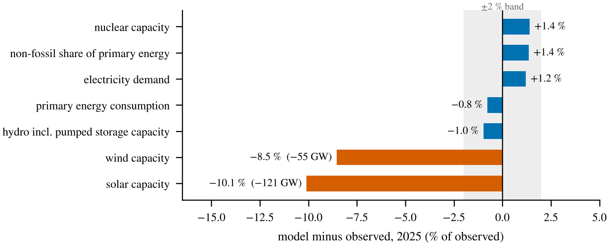
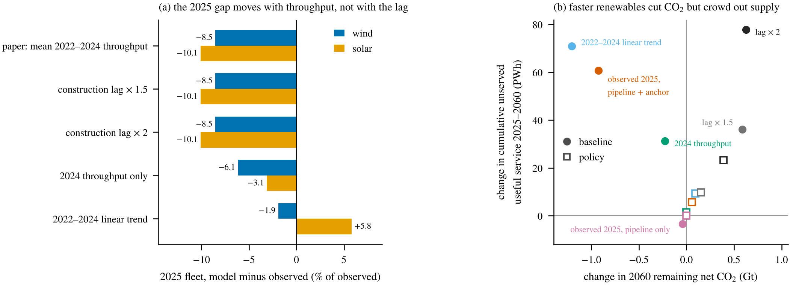

# Multi-energy transition under construction lags and repeated shocks — multi-agent simulation and security-constrained optimisation

**Competition:** 2nd National College Student Simulation Modeling Application Challenge (全国大学生仿真建模应用挑战赛), 2026, Problem A · entry ACSF2605371

**Read first:** [`paper/ACSF2605371_paper_zh_extended.pdf`](paper/ACSF2605371_paper_zh_extended.pdf) — the extended edition: the submitted document, unchanged (Part I, in Chinese), followed by the post-competition extensions written up in English as Part II (pages E-1 to E-3). The file as submitted, `paper/ACSF2605371_paper_zh.pdf`, is kept as handed in.

The question is when investment turns into deliverable energy, and how storage and coordination absorb
consecutive shocks during China's multi-energy transition. The model couples four agent classes —
government, energy-consuming sectors, generation/storage investors, fuel suppliers — through a
217-dimensional state, explicit construction queues and three-fuel conservation, linking annual
evolution (2025–2060) with hourly operation. It was implemented and run in MATLAB/Simulink and AnyMath,
with Python for data preparation, experiment design, optimisation and figures.

## Findings of the competition paper

| Question | Result |
|---|---|
| Status 2024 | primary energy 5.96 Gt standard coal, coal 53.2 %, wind + solar 18.3 % of generation |
| Dual-carbon scenarios | baseline 2030 energy CO₂ 11.351 Gt, peak not confirmed by 2060 (12.639 Gt residual net emissions); policy-strengthened 9.325 Gt; the three active feedbacks cut end-point CO₂ by 0.283 Gt while adding 3.011 PWh of unserved useful service |
| Security optimisation | 2 460 investment controls screened under ≤ 1 % annual service shortfall in five services; nominal compromise reliable in 3/48 development perturbations, repaired plan 20/48, independent designs 21/48, at +26.5 trillion CNY discounted capital and +2.04 Gt 2060 net emissions; 196 construction-timing paths show that expansion size, capital allocation and commissioning clock must be evaluated jointly |
| Hourly coordination | coordination saves 109.455 GWh (2.073 %) of unserved energy versus an all-source-reserve rule; +50 % storage power shaves peaks in 29/32 cells but reduces cumulative shortfall in only 5; offline energy bounds explain a 5.170 TWh lower bound |

## Post-competition extension: does the model get 2025 right?

The model is calibrated on the 2010–2024 yearbook vintage, and its first simulated year — fixed by the
2024 state and the construction queue, identical across all investment plans — can now be checked against
official 2025 statistics published afterwards (NBS statistical communiqué of 28 Feb 2026, NBS energy-mix
supplement of June 2026, NEA power statistics). Script: `extension/e1_holdout_2025.py`.

| Quantity (2025) | Model | Observed | Error |
|---|---:|---:|---:|
| Primary energy consumption (Mtce) | 6 122 | 6 170 | −0.8 % |
| Electricity demand vs. consumption (TWh) | 10 493 | 10 368 | +1.2 % |
| Non-fossil share of primary energy | 22.0 % | 21.7 % | +0.3 pp |
| Hydro incl. pumped storage (GW) | 444 | 448 | −1.0 % |
| Nuclear (GW) | 63.4 | 62.5 | +1.4 % |
| Wind (GW) | 585 | 640 | **−8.5 %** |
| Solar (GW) | 1 080 | 1 202 | **−10.1 %** |



*Relative errors; the non-fossil share is plotted as a relative error of the share (+1.4 %), i.e. +0.3 pp.*

Energy totals, structure and slow-moving capacity are reproduced to within about 1.4 %, but the
construction queue under-delivers the record 2025 wind and solar additions by 55 GW and 121 GW. E2 below
traces this residual to its source and follows it through to the paper's conclusions. (Thermal capacity is
not compared because the statistical "thermal" category also includes oil-fired and waste-to-energy plants
absent from the model.)

### E2 — what the 2025 gap identifies, and what correcting it changes

In the model the 2025 fleet is the 2024 fleet plus the first slot of the *initial construction pipeline*.
The paper estimates that pipeline from steady throughput, i.e. the mean net addition of 2022–2024: wind
64 GW/yr (37, 76, 79) and solar 193 GW/yr (86, 217, 277). New orders need at least one year, so the
construction lag cannot reach 2025. Script: `extension/e3_pipeline_recalibration.py` (Python annual
kernel of the submission; the native run reproduces the stored contest metrics exactly).

* **The residual identifies the throughput, not the lag.** Lengthening the construction lag of new orders
  by a factor of 1.5 or 2 leaves the 2025 fleet unchanged (585 GW wind, 1 080 GW solar). Changing the
  throughput estimate moves it one for one. Information available in early 2025 would have helped:
  2024's throughput alone cuts the errors to −6.1 % (wind) and −3.1 % (solar), a mean absolute gap of
  38 GW instead of 88 GW. A linear trend over 2022–2024 overshoots solar (+5.8 %).
* **Consequences.** The same throughput enters the investors' reference build path, so the model is
  re-anchored to the observed 2025 build in both places. Then:

  | Baseline result | Paper | Re-anchored to 2025 | Change |
  |---|---:|---:|---:|
  | 2030 energy CO₂ | 11.351 Gt | 11.017 Gt | −2.9 % |
  | 2060 remaining net CO₂ | 12.639 Gt | 11.713 Gt | −7.3 % |
  | Cumulative unserved useful service, 2025–2060 | 35.4 PWh | 96.1 PWh | ×2.7 |

  Correcting only the 2025 pipeline, with the anchor left as in the paper, changes 2060 by just −0.04 Gt.
  The paper's qualitative findings survive every variant: the baseline has no emissions peak before 2060,
  and under every throughput estimator the policy scenario's 2060 residual stays within 9.32–9.42 Gt
  (paper: 9.325 Gt). Only a longer construction lag moves it further, to 9.48 Gt (×1.5) and 9.72 Gt (×2).
* **Mechanism.** The annual investment budget binds in all 36 simulated years. A faster renewable anchor
  therefore re-allocates capital rather than adding it:

  | Cumulative capital, baseline (trillion CNY) | Paper | Re-anchored to 2025 |
  |---|---:|---:|
  | Wind + solar | 44.3 | 49.7 |
  | Firm generation | 17.9 | 15.8 |
  | Fuel supply | 7.7 | 4.4 |

  As a result, unserved direct fuel rises from 4 789 to 12 635 Mtce and unserved electricity from 2 546 to
  9 663 TWh. Lengthening the lag instead raises both the 2060 CO₂ residual and unserved service (Fig. E2b).

The 2025 statistics therefore sharpen the paper's central trade-off rather than overturn it: faster
renewable delivery lowers emissions, but under a shared budget it raises service shortfalls unless
supply-side investment is financed separately. The near-term renewable trajectories are conservative,
while the security results are, if anything, optimistic for a world that builds renewables at the 2025
pace.



*Fig. E2 — (a) 2025 fleet error for three throughput estimators of the initial pipeline and for two longer
construction lags of new orders. (b) Change against the paper's run by 2060 in remaining net CO₂ and
cumulative unserved useful service; filled markers are the baseline scenario, open markers the policy
scenario.*

## Reproduce

```bash
pip install -r support_material/requirements.txt
python extension/e1_holdout_2025.py
python extension/e2_figure.py
python extension/e3_pipeline_recalibration.py     # ~1 min, Python annual kernel
python extension/e4_figure_pipeline.py
cd support_material && python -X utf8 复现图表与论文.py     # redraws the six main figures and recompiles the paper (XeLaTeX)
```

The long-run simulations were executed in MATLAB/Simulink (`support_material/start_v9_lab.m`,
`support_material/simulation/`) and AnyMath; their outputs are stored in `support_material/outputs/`.

## Layout

```
support_material/   submitted support package: src/ (Python, v3–v18), simulation/ (Simulink/AnyMath),
                    config/, data/ (public statistics), outputs/, paper sources, figures
paper/              competition paper (Chinese, 57 pages) as submitted, and its extended edition with Part II (*_extended.pdf)
extension/          2025 out-of-sample check, pipeline recalibration and figure scripts
results/extension/  comparison tables and summaries
figures/extension/  figures
```

## Licence

Code: MIT. Paper and figures: CC BY 4.0. Statistical inputs remain with their publishers.
